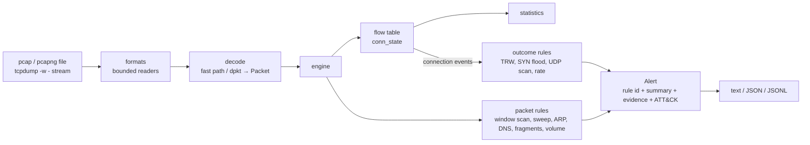

# NetGuard

**Network intrusion detection & traffic analysis with explainable, measured detections.**

[](https://github.com/furkan-akkaya/NetGuard/actions/workflows/ci.yml)


NetGuard reads network traffic (pcap/pcapng files or a live `tcpdump` stream),
reconstructs connections (flows with Zeek-compatible connection states),
detects reconnaissance and layer-2 attacks, and reports each finding as a
single **explainable alert**. Every alert states what was observed, which
threshold it crossed, what the attacker likely learned, and which MITRE ATT&CK
technique it maps to.

> **Status:** v0.8.0 — packet ingestion, flow engine, eleven detection rules
> with explainable confidence, alert correlation, a REST API, a web dashboard
> and live capture, tested on 27 labelled synthetic scenarios and hardened
> against a written threat model. Validation on real lab captures is next
> (see the [roadmap](ROADMAP.md)).

```text
$ netguard analyze syn_scan.pcap

NetGuard 0.8.0 — syn_scan.pcap

Packets: 2,003   Bytes: 108,162   Duration: 1.0s   Flows: 1,000   Decode errors: 0
Protocols: tcp 2,003
Flow states: REJ 997, RSTO 3
Top services (flows): tcp/21 1, tcp/22 1, tcp/23 1, tcp/25 1, tcp/53 1
Top talkers: 10.0.0.10 (108,162 B), 10.0.0.66 (108,162 B)

Alerts: 1 (1 HIGH)

[HIGH] TCP port scan: 10.0.0.66 -> 10.0.0.10  T1046 Network Service Discovery
    10.0.0.66 probed 1000 distinct TCP ports on 10.0.0.10 in 1.0s (threshold: 15 ports
    within 60s). Probes: SYN=1000. Target replies: 3 open, 997 closed, 0 unanswered.
    Open: 22, 80, 443.
    2025-10-09 08:53:20.000Z → 2025-10-09 08:53:20.999Z  rule=NG-SCAN-001 detector=portscan
```

`REJ 997, RSTO 3` is the flow-level view of the same scan: 997 closed ports
answered the SYN with RST; the 3 open ports answered SYN-ACK and the scanner
aborted with RST (a half-open scan).

## Features

| Rule | Detects | ATT&CK | How |
|---|---|---|---|
| [NG-SCAN-001](docs/rules/NG-SCAN-001.md) | SYN, connect, NULL, FIN, XMAS port scans | [T1046](https://attack.mitre.org/techniques/T1046/) | Distinct ports per (source, target) in a sliding window, one incident per scan; reports open/closed ports; ignores incidents where most ports were open (a client, not a scanner). |
| [NG-SCAN-002](docs/rules/NG-SCAN-002.md) | Scans by connection outcome, incl. slow scans | [T1046](https://attack.mitre.org/techniques/T1046/) | Threshold Random Walk (sequential hypothesis test) over first-contact successes and failures. No time window. |
| [NG-SCAN-003](docs/rules/NG-SCAN-003.md) | UDP port scans | [T1046](https://attack.mitre.org/techniques/T1046/) | Distinct UDP ports per (originator, target); open/closed/filtered from UDP replies and ICMP unreachables. |
| [NG-SWEEP-001](docs/rules/NG-SWEEP-001.md) | ICMP/ARP ping sweeps, horizontal TCP scans | [T1018](https://attack.mitre.org/techniques/T1018/) | Distinct hosts per source in a sliding window; reports which hosts were found alive. |
| [NG-SYN-001](docs/rules/NG-SYN-001.md) | TCP SYN floods | [T1499.001](https://attack.mitre.org/techniques/T1499/001/) | Many attempts, few completed handshakes per target; source-diversity evidence for spoofing. |
| [NG-ARP-001](docs/rules/NG-ARP-001.md) | ARP cache poisoning / MITM | [T1557.002](https://attack.mitre.org/techniques/T1557/002/) | IP→MAC binding changes with context: unsolicited replies, flip-flopping, critical IPs, suspect MAC. |
| [NG-DNS-001](docs/rules/NG-DNS-001.md) | DNS tunnelling / exfiltration | [T1071.004](https://attack.mitre.org/techniques/T1071/004/) | Many long, unique subdomains of one registered domain; entropy and record types as evidence. |
| [NG-DNS-002](docs/rules/NG-DNS-002.md) | DGA malware | [T1568.002](https://attack.mitre.org/techniques/T1568/002/) | Bursts of NXDOMAIN responses; domain spread tells DGA from a wrong search suffix. |
| [NG-FRAG-001](docs/rules/NG-FRAG-001.md) | Fragmentation evasion (`nmap -f`) | [T1599](https://attack.mitre.org/techniques/T1599/) | Tiny first fragments, TCP header split at offset 8, sub-MTU fragments (RFC 1858). |
| [NG-RATE-001](docs/rules/NG-RATE-001.md) | Unusual connection frequency | — | New connections per host vs. the host's own EWMA baseline. |
| [NG-VOL-001](docs/rules/NG-VOL-001.md) | Abnormal outbound volume | — | Bytes sent per host vs. the host's own EWMA baseline. |

Every alert carries an **explainable confidence** (5–95, with the evidence
factors that raised or lowered it), and alerts about the same actor are
**correlated into incidents** with their ATT&CK tactics ([CONFIDENCE.md](docs/CONFIDENCE.md)).
ARP alerts consult DHCP leases from a trusted server, so a device simply
re-assigned an IP is not reported as spoofing.

Each rule is documented in the [rule catalog](docs/rules/README.md) (signal,
thresholds, evidence, known false positives and negatives, tuning);
`netguard rules` lists them with their state in your configuration.

Traffic analysis:

- **Flows:** bidirectional connections with originator, per-direction packets/bytes/payload, duration, TCP history, Zeek-style `conn_state` (`S0`, `REJ`, `SF`, `RSTO`, …), retransmission and sequence-gap counts. Export with `netguard flows`.
- **DNS:** queries and responses (name, type, response code) from NetGuard's own bounded parser.
- **Statistics:** protocol and packet-size distributions, time series, flow states, top services, top flows, top endpoints (sent/received).
- **Capture formats:** pcap and pcapng, including multi-interface pcapng with different link types; Ethernet, Linux SLL, BSD loopback, raw IP; IPv4/IPv6; TCP, UDP, ICMP, ICMPv6, ARP, DNS (queries and responses), DHCP (leases).

Engineering properties:

- **Explainable.** Every alert carries a plain-language summary and structured evidence, including the thresholds it crossed.
- **Low noise.** Activity is grouped into incidents: a 65,535-port scan produces one alert, not 65,535.
- **Measured.** Labelled benign and attack scenarios run in CI. Precision, recall and the known false positives are published in [EVALUATION.md](docs/EVALUATION.md).
- **Robust.** Every byte is treated as hostile. Malformed frames and capture files are counted or rejected, never fatal, and fuzz-tested. All state has memory bounds, and hitting a bound costs O(1), so a spoofed-source flood cannot exhaust memory or CPU.
- **Deterministic.** Detectors use capture timestamps instead of the wall clock, so the same pcap always gives the same result.
- **Minimal.** The analyzer has one runtime dependency ([dpkt](https://github.com/kbandla/dpkt)); capture-file readers and the hot decode path are NetGuard's own, bounded code. The API (FastAPI, SQLite) is an optional extra. NetGuard never needs root: live capture is delegated to `tcpdump`.
- **Secure defaults.** The API binds to localhost, requires a token for remote access, streams uploads with a hard cap, and analyses every capture in a separate, time- and memory-limited process. The dashboard renders capture data only as text under a strict Content-Security-Policy.

## Quick start

Requires Python ≥ 3.11 and [uv](https://docs.astral.sh/uv/).

```bash
git clone https://github.com/furkan-akkaya/NetGuard.git && cd NetGuard
uv sync
uv run netguard lab generate lab-pcaps/        # write the labelled scenarios as pcaps
uv run netguard analyze lab-pcaps/arp_spoof_mitm.pcap
uv run netguard lab evaluate                   # scorecard over all scenarios
```

### Usage

```bash
# Offline analysis
netguard analyze capture.pcapng
netguard analyze -f json capture.pcap > report.json      # one JSON document
netguard analyze -c netguard.toml capture.pcap           # custom thresholds / allowlist
netguard flows capture.pcap > flows.csv                  # connection records (CSV)
netguard config > netguard.toml                          # the full effective configuration, to edit
netguard flows -f jsonl capture.pcap | jq 'select(.state=="S0")'

# Live: NetGuard starts tcpdump on one interface and alerts as incidents open and close
netguard monitor -i eth0 --filter 'not port 22' --duration 3600
netguard replay capture.pcap --speed 10      # recorded traffic through the live pipeline
```

### Dashboard and REST API

```bash
uv sync                                   # or: pip install 'netguard[web]'
pnpm --dir frontend install && pnpm --dir frontend build   # once: builds the dashboard bundle
uv run netguard serve --data-dir ./netguard-data            # http://127.0.0.1:8000
```

The dashboard shows a security overview, traffic statistics and charts,
protocol, connection-state and endpoint breakdowns, a flow browser, an alert
feed with filters and full evidence, capture upload with live job status,
rule profiles for re-analysing with different thresholds, and exports (HTML
report, alerts as NDJSON or Elastic Common Schema, flows as CSV). Everything
it shows comes from real analyses; nothing is mocked.


More screenshots and the exact steps to reproduce them: [docs/DEMO.md](docs/DEMO.md).

The same functions are available through the REST API: [docs/API.md](docs/API.md).
`netguard analyze -f html capture.pcap > report.html` writes the same
single-file report from the command line.

`monitor` needs tcpdump to have capture permission; NetGuard itself never runs
as root. See [docs/LIVE_CAPTURE.md](docs/LIVE_CAPTURE.md) for permissions,
options and measured detection delays.

`-f jsonl` writes one JSON alert per line as soon as it is emitted: in live
mode an `early` alert when an incident crosses its threshold and a `final`
one with the same `alert_id` when it closes. This
format fits `jq`, Filebeat, Vector or a SIEM. The default thresholds are listed
in [`netguard.example.toml`](netguard.example.toml).

## Measured results

From `netguard lab evaluate` on 27 labelled synthetic scenarios (15 attacks,
12 benign look-alikes). Scoring is per entity; see
[EVALUATION.md](docs/EVALUATION.md) for the method and full table.

| | Result |
|---|---|
| Attack scenarios detected | 15 / 15 (the slow scan only by the outcome-based TRW rule, not the window rule) |
| Benign scenarios without false positives | 9 / 12 (known FPs: monitoring poller, DHCP re-assignment without visible DHCP, wrong DNS search suffix — all three scored *low* confidence) |
| Throughput | ~97k packets/s incl. start-up with all 11 rules, 36 MB RSS (242k-packet reference pcap, Apple M1, single core) |
| Worst case | 500k-source spoofed SYN flood: 469 MB peak RSS, bounded by configuration |

All of these numbers come from synthetic traffic that we designed ourselves,
together with the rules. They show the detection logic works as intended and
expose the known blind spots. They are not a claim about accuracy on real
networks. Validation on real captures is part of [Phase 8](ROADMAP.md).

## Architecture



See [ARCHITECTURE.md](docs/ARCHITECTURE.md) and the [decision records](docs/adr/).

## Documentation

| | |
|---|---|
| [Roadmap](ROADMAP.md) | Current state, phases, MVP scope, exit criteria, test strategy (Turkish) |
| [Tasks](docs/TASKS.md) | Current task board |
| [Architecture](docs/ARCHITECTURE.md) | Components, data flow, extension points |
| [API](docs/API.md) | REST API v1 reference, examples, ECS export |
| [Live capture](docs/LIVE_CAPTURE.md) | `monitor` and `replay`: permissions, options, alert lifecycle |
| [Deployment](docs/DEPLOYMENT.md) | Install, systemd service, TLS proxy, upgrades |
| [Threat model](docs/THREAT_MODEL.md) | Entry points, threats, mitigations, residual risks |
| [Confidence](docs/CONFIDENCE.md) | How confidence is computed (every factor justified) and how alerts become incidents |
| [Contributing](CONTRIBUTING.md) | Development setup (Python and dashboard), checks before committing |
| [ADRs](docs/adr/) | Eleven decisions: Python + dpkt, tcpdump capture, incidents, flows, capture readers, connection events, baselines, backend, dashboard, live capture, Phase 7 scope |
| [Rule catalog](docs/rules/README.md) | One page per detection rule |
| [Evaluation](docs/EVALUATION.md) | Method, scorecard, benchmark, limitations |
| [Engineering report](docs/ENGINEERING_REPORT.md) | What was built, verified and not verified; defects found by measuring |
| [Demo](docs/DEMO.md) | Screenshots and CLI output from real runs, with reproduction steps |
| [Lab setup](docs/LAB_SETUP.md) | Building a safe UTM/Kali/Ubuntu lab to validate detections |
| [Learning notes](docs/learning/) | Technical deep-dives (Turkish) |

## Development

```bash
uv sync
uv sync --all-extras         # include the web extra for the API tests
uv run pytest --cov          # tests + coverage
uv run ruff check . && uv run ruff format --check .
uv run mypy                  # strict type checking
```

## Responsible use

NetGuard is a defensive tool. Generate attack traffic only in a lab you own or
where you have explicit written authorization. See [SECURITY.md](SECURITY.md).

## License

[MIT](LICENSE) © Furkan Akkaya
