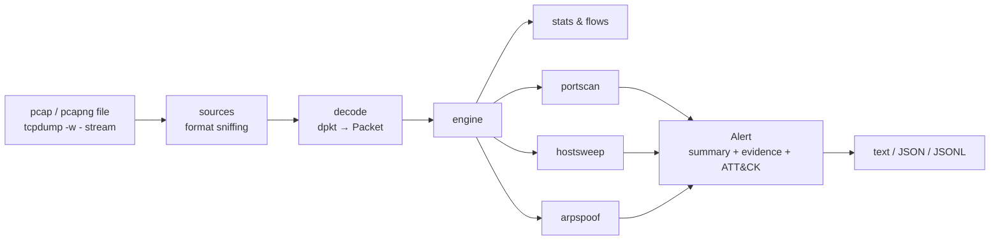

# NetGuard

**Network intrusion detection & traffic analysis with explainable, measured detections.**

[](https://github.com/furkan-akkaya/NetGuard/actions/workflows/ci.yml)


NetGuard reads network traffic (pcap/pcapng files or a live `tcpdump` stream),
detects reconnaissance and layer-2 attacks, and reports each finding as a
single **explainable alert**. Every alert states what was observed, which
threshold it crossed, what the attacker likely learned, and which MITRE ATT&CK
technique it maps to.

> **Status:** v0.1 MVP. Three detectors, tested on labelled synthetic scenarios.
> Validation on real lab captures is in progress (see the [roadmap](docs/ROADMAP.md)).

```text
$ netguard analyze syn_scan.pcap

NetGuard 0.1.0 — syn_scan.pcap

Packets: 2,003   Bytes: 108,162   Duration: 1.0s   Flows: 1,000   Decode errors: 0
Protocols: tcp 2,003
Top talkers: 10.0.0.66 (54,162 B), 10.0.0.10 (54,000 B)

Alerts: 1 (1 HIGH)

[HIGH] TCP port scan: 10.0.0.66 -> 10.0.0.10  T1046 Network Service Discovery
    10.0.0.66 probed 1000 distinct TCP ports on 10.0.0.10 in 1.0s (threshold: 15 ports
    within 60s). Probes: SYN=1000. Target replies: 3 open, 997 closed, 0 unanswered.
    Open: 22, 80, 443.
```

## Features

| Detector | Detects | ATT&CK | How |
|---|---|---|---|
| `portscan` | SYN, connect, NULL, FIN, XMAS port scans | [T1046](https://attack.mitre.org/techniques/T1046/) | Distinct destination ports per (source, target) in a sliding window, aggregated into one incident per scan. Reports open/closed ports from the target's replies. |
| `hostsweep` | ICMP ping sweeps, ARP sweeps, horizontal TCP scans | [T1018](https://attack.mitre.org/techniques/T1018/) | Distinct destination hosts per source in a sliding window. Reports which hosts replied (were found alive). |
| `arpspoof` | ARP cache poisoning / MITM | [T1557.002](https://attack.mitre.org/techniques/T1557/002/) | Learns IP→MAC bindings and flags changes. Adds context: unsolicited replies, flip-flopping, critical IPs. Identifies the suspect MAC. |

Engineering properties:

- **Explainable.** Every alert carries a plain-language summary and structured evidence, including the thresholds it crossed.
- **Low noise.** Activity is grouped into incidents: a 65,535-port scan produces one alert, not 65,535.
- **Measured.** Labelled benign and attack scenarios run in CI. Precision, recall and the known false positives are published in [EVALUATION.md](docs/EVALUATION.md).
- **Robust.** The decoder treats every byte as hostile. Malformed frames are counted, never fatal, and fuzz-tested. All detector state has memory bounds.
- **Deterministic.** Detectors use capture timestamps instead of the wall clock, so the same pcap always gives the same result.
- **Minimal.** One runtime dependency ([dpkt](https://github.com/kbandla/dpkt)). NetGuard never needs root: live capture is delegated to `tcpdump`.

## Quick start

Requires Python ≥ 3.11 and [uv](https://docs.astral.sh/uv/).

```bash
git clone https://github.com/furkan-akkaya/NetGuard.git && cd NetGuard
uv sync
uv run netguard lab generate lab-pcaps/        # write the labelled scenarios as pcaps
uv run netguard analyze lab-pcaps/arp_spoof_mitm.pcap
uv run netguard lab evaluate                   # scorecard over all scenarios
```

### Usage

```bash
# Offline analysis
netguard analyze capture.pcapng
netguard analyze -f json capture.pcap > report.json      # one JSON document
netguard analyze -c netguard.toml capture.pcap           # custom thresholds / allowlist

# Live: tcpdump captures (as root), NetGuard analyzes (as your user)
sudo tcpdump -i eth0 -U -w - 'not port 22' | netguard analyze -f jsonl -
```

`-f jsonl` writes one JSON alert per line as soon as an incident closes. This
format fits `jq`, Filebeat, Vector or a SIEM. The default thresholds are listed
in [`netguard.example.toml`](netguard.example.toml).

## Measured results

The following comes from `netguard lab evaluate` on 11 labelled synthetic
scenarios (6 attack, 5 benign). Scoring is per entity. See
[EVALUATION.md](docs/EVALUATION.md) for the method and full table.

| | Result |
|---|---|
| Attacks detected | 5 / 6 (the missed one is a deliberate *slow scan*: 1 probe every 15 s) |
| Benign scenarios with false positives | 3 / 5 (monitoring poller, DHCP re-assignment, passive FTP) |
| Throughput | ~60k packets/s, ~37 MB RSS (242k-packet pcap, Apple M1, single core) |

All of these numbers come from synthetic traffic that we designed ourselves.
They show the detection logic works as intended and expose the known blind
spots. They are not a claim about accuracy on real networks.
Validation on real captures is part of [Phase 2](docs/ROADMAP.md).

## Architecture



See [ARCHITECTURE.md](docs/ARCHITECTURE.md) and the [decision records](docs/adr/).

## Documentation

| | |
|---|---|
| [Roadmap](docs/ROADMAP.md) | Phases, goals, learning objectives, exit criteria |
| [Tasks](docs/TASKS.md) | Current task board |
| [Architecture](docs/ARCHITECTURE.md) | Components, data flow, extension points |
| [ADRs](docs/adr/) | Why Python + dpkt, why tcpdump for capture, why incidents |
| [Evaluation](docs/EVALUATION.md) | Method, scorecard, benchmark, limitations |
| [Lab setup](docs/LAB_SETUP.md) | Building a safe UTM/Kali/Ubuntu lab to validate detections |
| [Learning notes](docs/learning/) | Technical deep-dives (Turkish) |

## Development

```bash
uv sync
uv run pytest --cov          # tests + coverage
uv run ruff check . && uv run ruff format --check .
uv run mypy                  # strict type checking
```

## Responsible use

NetGuard is a defensive tool. Generate attack traffic only in a lab you own or
where you have explicit written authorization. See [SECURITY.md](SECURITY.md).

## License

[MIT](LICENSE) © Furkan Akkaya
