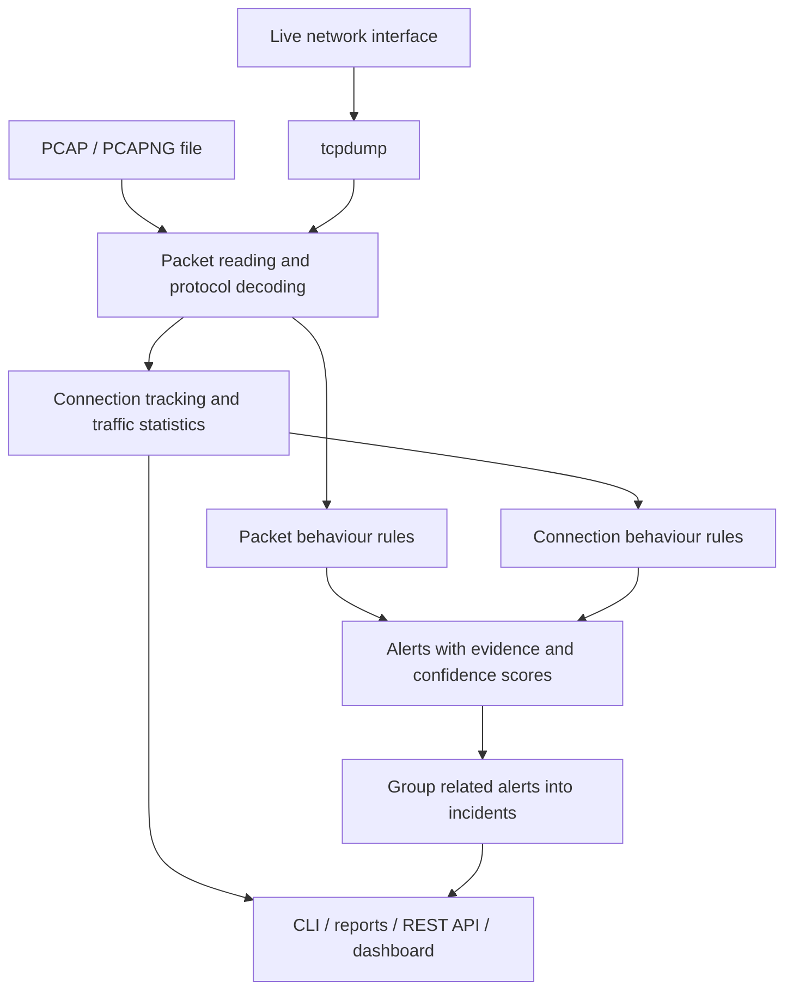

# NetGuard

**English** | [Türkçe](README.tr.md)

**A passive network intrusion detection tool that explains suspicious traffic with evidence.**

[](https://github.com/furkan-akkaya/NetGuard/actions/workflows/ci.yml)


NetGuard analyses **PCAP/PCAPNG files** or **live traffic** from a network interface.
It reconstructs connections and looks for port scans, suspicious DNS activity, ARP binding changes and traffic bursts.
Results are available through the command line, a web dashboard and a REST API.

Each alert identifies the source and target, describes the observed behaviour, shows the crossed threshold and explains its confidence score.
Related alerts are grouped into incidents.

> **Status: 1.0.0rc1 — release candidate.** Development and validation history is recorded in [PR #9](https://github.com/furkan-akkaya/NetGuard/pull/9).
> Validated against 17 accepted real lab captures and automated tests.
> No tag or GitHub release exists yet. See the [delivery report](docs/DELIVERY_REPORT.md) for open limitations and release steps.

## How it works



1. **Read traffic.** Consume packets from a file or capture live traffic through `tcpdump`.
2. **Track connections.** Match both directions and calculate packet counts, bytes, duration and TCP connection states.
3. **Evaluate behaviour.** Eleven rules inspect packets and connection outcomes.
4. **Explain alerts.** Report thresholds, source/target information, confidence factors and MITRE ATT&CK mappings where applicable.
5. **Support investigation.** Group related alerts and provide filterable, exportable results.

**NetGuard is passive:** it does not block traffic, write firewall rules or launch attacks automatically.
It can only analyse traffic visible at the capture point.
Being on the same network does not give it visibility into every other device's traffic.

## What it detects

| Rule | Behaviour |
|---|---|
| [NG-SCAN-001](docs/rules/NG-SCAN-001.md) | SYN, connect, NULL, FIN and XMAS port scans |
| [NG-SCAN-002](docs/rules/NG-SCAN-002.md) | Scans identified by successful and failed connection outcomes, including slow scans |
| [NG-SCAN-003](docs/rules/NG-SCAN-003.md) | UDP port scans |
| [NG-SWEEP-001](docs/rules/NG-SWEEP-001.md) | ICMP/ARP host discovery and horizontal TCP scans |
| [NG-SYN-001](docs/rules/NG-SYN-001.md) | Many SYN attempts with few completed handshakes |
| [NG-ARP-001](docs/rules/NG-ARP-001.md) | Suspicious IP–MAC binding changes |
| [NG-DNS-001](docs/rules/NG-DNS-001.md) | Long, unique subdomain queries consistent with DNS tunnelling |
| [NG-DNS-002](docs/rules/NG-DNS-002.md) | NXDOMAIN bursts that may indicate DGA-like activity |
| [NG-FRAG-001](docs/rules/NG-FRAG-001.md) | Suspicious small IP fragments or split transport headers |
| [NG-RATE-001](docs/rules/NG-RATE-001.md) | Increased new connections relative to a host's own baseline |
| [NG-VOL-001](docs/rules/NG-VOL-001.md) | Increased outbound bytes relative to a host's own baseline |

These behaviours alone do not prove an attack.
For example, DNS misconfiguration can produce NXDOMAIN responses, and legitimate telemetry can use long DNS names.
The [rule catalog](docs/rules/README.md) documents thresholds and known false positives.
Confidence is not a statistical attack probability; it comes from [documented evidence factors](docs/CONFIDENCE.md).

## Quick start

Requires Python **3.11–3.14**, Linux or macOS, and `uv`.
The example generates traffic files locally; analysing them needs no capture privileges or network access.
Installing dependencies for the first time requires internet access.

There is no published release yet. Install the current source from `main`:

```bash
git clone --branch main https://github.com/furkan-akkaya/NetGuard.git
cd NetGuard
uv sync --locked

# Generate labelled traffic files.
uv run netguard lab generate lab-pcaps/

# Analyse an example containing several suspicious behaviours.
uv run netguard analyze lab-pcaps/compromised_workstation.pcap

# Show the evaluation scorecard for all synthetic scenarios.
uv run netguard lab evaluate
```

Cloning a private repository requires GitHub access.
Generated files are synthetic; real lab captures are not included in the repository.

### Example result

An excerpt from `1.0.0rc1` analysing the `compromised_workstation` scenario above:

```text
Packets: 582   Bytes: 39,748   Duration: 70.2s   Flows: 321   Decode errors: 0

Alerts: 4 (3 HIGH, 1 MEDIUM)
Incidents: 1 (alerts grouped by actor and time)
```

In this example, `10.0.0.20` sends queries consistent with DNS tunnelling, scans a server and sends fragmented probes.
NetGuard groups four alerts into one incident associated with that source.
See the [demo](docs/DEMO.md) for full output and screenshots.

## Web dashboard

Building the dashboard from source also requires **Node.js ≥ 22** and the project's specified **pnpm 11.25.0**.
`uv sync` includes the web dependencies in the development environment.

```bash
pnpm --dir frontend install --frozen-lockfile
pnpm --dir frontend build
uv run netguard serve --data-dir ./netguard-data
```

Open **http://127.0.0.1:8000** in your browser.
Upload a PCAP under **Captures**, then inspect connections, traffic statistics and alert evidence after analysis.


The dashboard provides analysis history, traffic charts, a flow browser, alert filters and rule profiles.
Export HTML reports, CSV connection records and JSONL/ECS alerts.
The screenshot comes from an actual analysis of synthetic traffic; its version is recorded in the [demo](docs/DEMO.md).

`serve` provides file analysis and the dashboard.
Use the separate `monitor` command for live capture.
See the [API reference](docs/API.md) for endpoints and examples.

## Usage

### File analysis and reports

```bash
uv run netguard analyze capture.pcapng
uv run netguard analyze -f json capture.pcap > report.json
uv run netguard analyze -f html capture.pcap > report.html
uv run netguard flows capture.pcap > flows.csv
uv run netguard rules
```

Export and edit the configuration to customise thresholds and allowlists:

```bash
uv run netguard config > netguard.toml
uv run netguard analyze -c netguard.toml capture.pcap
```

Example configuration: [`netguard.example.toml`](netguard.example.toml).

### Live traffic

Requires `tcpdump`.
Replace `eth0` with your interface name and capture only on networks you are authorised to monitor.

```bash
sudo -v
uv run netguard monitor -i eth0 --sudo --duration 60 --write session.pcap
```

NetGuard runs as a normal user; `--sudo` starts `tcpdump` for capture only.
`--write` also saves the capture to a file.
See [live capture](docs/LIVE_CAPTURE.md) for permissions, filters and recording limits.

Replay a recording through the live pipeline or write alert events as JSONL:

```bash
uv run netguard replay capture.pcap --speed 10
uv run netguard monitor -i eth0 --sudo --duration 60 -f jsonl > alerts.jsonl
```

Live mode can emit an early warning and a final alert for one incident.
Do not count these two stages, sharing the same `alert_id`, as separate attacks.

## Validation and test results

| Check | Measured result | Scope |
|---|---|---|
| Automated Python tests | 425 tests | Linux/macOS × Python 3.11–3.14 CI matrix |
| Dashboard | 14 tests and successful production build | UI tests |
| Synthetic attacks | 15/15 scenarios detected | Labelled scenarios designed with the project |
| Synthetic benign traffic | 9/12 scenarios without false positives | Three known false positives reported with low confidence |
| Real lab experiments | 17 accepted captures; expected detections across all eleven rules | Isolated Kali/Ubuntu UTM lab |
| One hour of benign traffic | 3640.1 seconds; zero alerts; approximately 34 MiB peak RSS | Low-rate SSH/ping traffic |
| Live early warnings | 0.683 and 0.757 seconds after threshold crossing | One SYN scan experiment |
| Release dry run | Installation, source archive, dashboard, SBOM and SHA256 checks passed | CI rehearsal without creating a tag or release |

Accepted real lab captures reported zero kernel packet drops.
Two initial runs with packet loss were rejected; their results and retries remain documented.
Connections were compared with Zeek 8.2.2, with timeout settings and fragmentation differences explicitly recorded.

These results do not establish general accuracy, false-positive rates or latency guarantees for real networks.
Each attack experiment is a single run; the benign hour covers a narrow traffic mix.
See the [evaluation](docs/EVALUATION.md) and [delivery report](docs/DELIVERY_REPORT.md) for methods, source versions and details.

## Limitations and security

- **No IP fragment reassembly.** Suspicious fragmentation is reported, but traffic inside fragments cannot be fully analysed by other rules.
- **No encrypted application payload decryption.** Analysis uses visible packet and connection information.
- **Visibility and loss affect results.** One-sided or incomplete captures can change connection states and detections.
- **Limited live-load validation.** Live runs longer than one hour or under high traffic load have not been completed.
- **Burst rules depend on initial observations.** Learning from the first partial interval remains an open design decision, task 8.17.
- **An alert starts an investigation.** Evaluate legitimate scanners, DNS patterns and device changes in your own network context.

The API binds to localhost by default.
For remote access, use a token, appropriate Host/Origin settings and a TLS reverse proxy.
PCAP files may contain sensitive information; review them before sharing.
See [deployment](docs/DEPLOYMENT.md) for installation and operation, and the [threat model](docs/THREAT_MODEL.md) for security controls.

## Technical overview

The analysis core is written in Python; its core runtime dependency is `dpkt`.
The web application uses FastAPI/Uvicorn, SQLite and React/TypeScript.
Live capture runs through `tcpdump`.

Resource bounds apply to capture readers and analysis state.
API analyses run in separate worker processes with time and memory limits.
Offline rules use capture timestamps, so the same file and configuration produce the same analysis result.
See the [architecture](docs/ARCHITECTURE.md) and [decision records](docs/adr/) for components and design rationale.

## Development

```bash
uv sync --locked
uv run pytest --cov
uv run ruff check .
uv run ruff format --check .
uv run mypy
pnpm --dir frontend test
pnpm --dir frontend build
```

Development setup and contribution guidelines: [CONTRIBUTING.md](CONTRIBUTING.md).
Security reporting: [SECURITY.md](SECURITY.md).

## Documentation

| Document | Contents |
|---|---|
| [Delivery report](docs/DELIVERY_REPORT.md) | Verified work, evidence and open limitations |
| [Release checklist](docs/RELEASE_CHECKLIST.md) | Steps from release candidate to release |
| [Roadmap](ROADMAP.md) / [tasks](docs/TASKS.md) | Project scope and current status |
| [Architecture](docs/ARCHITECTURE.md) | Components and data flow |
| [Rule catalog](docs/rules/README.md) | Behaviour, thresholds and limitations of each rule |
| [Confidence](docs/CONFIDENCE.md) | Alert reasoning and incident correlation |
| [API](docs/API.md) | Endpoints and output formats |
| [Live capture](docs/LIVE_CAPTURE.md) | Permissions, commands and alert stages |
| [Deployment](docs/DEPLOYMENT.md) | Package installation, systemd, TLS and upgrades |
| [Demo](docs/DEMO.md) | Screenshots and reproduction steps |
| [Evaluation](docs/EVALUATION.md) | Methods, results and measurement limits |
| [Lab setup](docs/LAB_SETUP.md) / [capture evaluation](docs/CAPTURE_EVALUATION.md) | Validating real traffic experiments |
| [Threat model](docs/THREAT_MODEL.md) | Security controls and residual risks |

## License

[MIT](LICENSE) — Furkan Akkaya.
