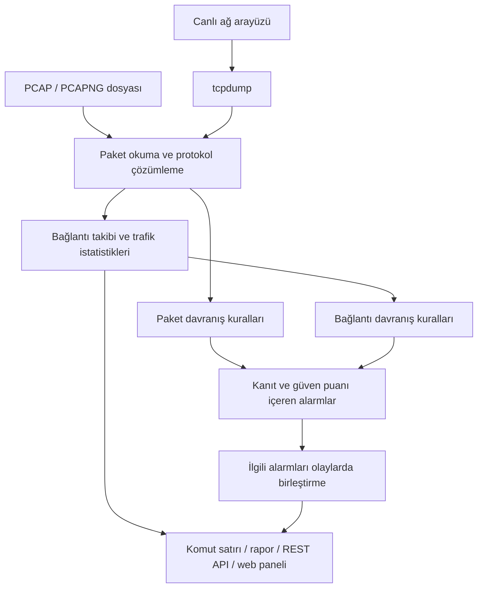
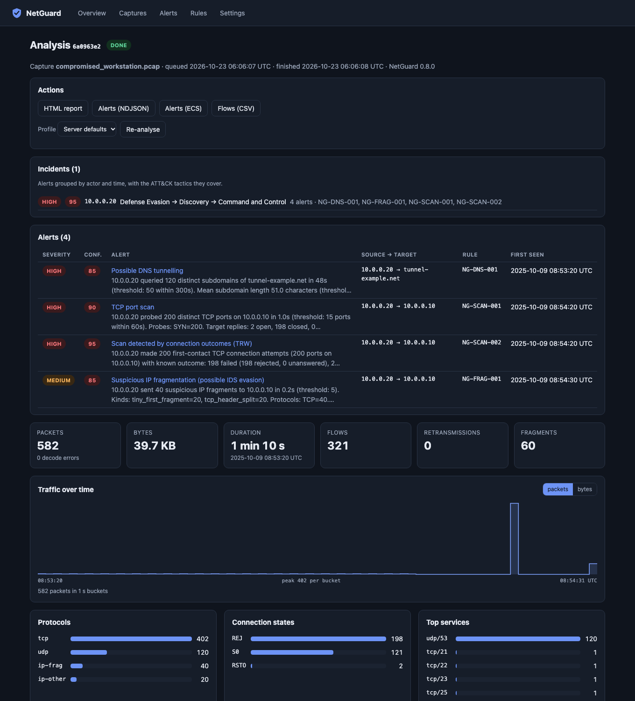

# NetGuard

[English](README.md) | **Türkçe**

**Ağ trafiğini inceleyen, şüpheli davranışları kanıtlarıyla açıklayan pasif saldırı tespit aracı.**

[](https://github.com/furkan-akkaya/NetGuard/actions/workflows/ci.yml)


NetGuard, kaydedilmiş **PCAP/PCAPNG dosyalarını** veya bir ağ arayüzündeki **canlı trafiği** analiz eder.
Paketleri bağlantılara dönüştürür; port taraması, şüpheli DNS kullanımı, ARP eşleşmesi değişiklikleri ve trafik artışlarını araştırır.
Sonuçları komut satırından, web panelinden veya REST API üzerinden sunar.

Bir alarm yalnızca “şüpheli trafik var” demez.
Kaynak ve hedefi, gözlenen davranışı, aşılan eşiği ve güven puanının gerekçelerini gösterir.
İlgili alarmları tek bir olay altında toplar.

> **Durum: 1.0.0rc1 — sürüm adayı.** Geliştirme ve doğrulama geçmişi [PR #9](https://github.com/furkan-akkaya/NetGuard/pull/9) içinde kayıtlı.
> 17 kabul edilmiş gerçek lab kaydı ve otomatik testlerle doğrulandı.
> Henüz tag veya GitHub release yok. Açık sınırlar ve yayın adımları [teslim raporunda](docs/DELIVERY_REPORT.md).

## Nasıl çalışır?



1. **Trafiği okur.** Dosyadan paket alır veya canlı yakalamayı `tcpdump` üzerinden yürütür.
2. **Bağlantıları izler.** İki yöndeki paketleri eşleştirir; paket, bayt, süre ve TCP bağlantı durumlarını hesaplar.
3. **Davranışları değerlendirir.** On bir kural, paketleri ve bağlantı sonuçlarını inceler.
4. **Alarmı açıklar.** Bulguyu eşikler, kaynak/hedef bilgisi, güven puanı ve uygun olduğunda MITRE ATT&CK eşlemesiyle raporlar.
5. **İncelemeyi kolaylaştırır.** Aynı aktörle ilişkili alarmları birleştirir; sonuçları filtrelenebilir ve dışa aktarılabilir biçimde sunar.

**NetGuard pasiftir:** trafiği engellemez, güvenlik duvarı kuralı yazmaz ve kendiliğinden saldırı başlatmaz.
Yalnızca yakalama noktasının görebildiği trafiği analiz eder.
Aynı ağda bulunmak, diğer cihazların bütün trafiğini görebileceği anlamına gelmez.

## Neleri tespit eder?

| Kural | Aradığı davranış |
|---|---|
| [NG-SCAN-001](docs/rules/NG-SCAN-001.md) | SYN, connect, NULL, FIN ve XMAS port taramaları |
| [NG-SCAN-002](docs/rules/NG-SCAN-002.md) | Başarılı ve başarısız bağlantılara göre taramalar; yavaş taramalar dahil |
| [NG-SCAN-003](docs/rules/NG-SCAN-003.md) | UDP port taramaları |
| [NG-SWEEP-001](docs/rules/NG-SWEEP-001.md) | ICMP/ARP ile cihaz arama ve yatay TCP taramaları |
| [NG-SYN-001](docs/rules/NG-SYN-001.md) | Çok sayıda SYN girişimi ve az tamamlanan el sıkışma |
| [NG-ARP-001](docs/rules/NG-ARP-001.md) | Şüpheli IP–MAC eşleşmesi değişiklikleri |
| [NG-DNS-001](docs/rules/NG-DNS-001.md) | DNS tünellemeyle uyumlu uzun ve benzersiz alt alan adı sorguları |
| [NG-DNS-002](docs/rules/NG-DNS-002.md) | DGA benzeri etkinliğe işaret edebilen NXDOMAIN yanıt artışları |
| [NG-FRAG-001](docs/rules/NG-FRAG-001.md) | Küçük veya başlığı bölen şüpheli IP parçaları |
| [NG-RATE-001](docs/rules/NG-RATE-001.md) | Cihazın kendi geçmişine göre yeni bağlantı sayısındaki artış |
| [NG-VOL-001](docs/rules/NG-VOL-001.md) | Cihazın kendi geçmişine göre gönderilen bayt miktarındaki artış |

Bu davranışlar tek başına saldırı kanıtı değildir.
Örneğin NXDOMAIN yanıtları yanlış DNS ayarlarından, uzun DNS adları meşru telemetriden kaynaklanabilir.
[Kural kataloğu](docs/rules/README.md), her kuralın eşiklerini ve bilinen yanlış alarm nedenlerini açıklar.
Güven puanı istatistiksel saldırı olasılığı değildir; [belgelenmiş kanıt faktörlerinden](docs/CONFIDENCE.md) hesaplanır.

## Hızlı başlangıç

Python **3.11–3.14**, Linux veya macOS ve `uv` gerekir.
İlk deneme için ağ erişimi veya yönetici yetkisi gerekmez; örnek trafik dosyaları yerel olarak üretilir.
Bağımlılıkların ilk kurulumu internet erişimi gerektirir.

Henüz yayınlanmış sürüm yok. Aşağıdaki komutlar güncel kaynak kodu `main` dalından kurar:

```bash
git clone --branch main https://github.com/furkan-akkaya/NetGuard.git
cd NetGuard
uv sync --locked

# Etiketlenmiş örnek trafik dosyalarını üret.
uv run netguard lab generate lab-pcaps/

# Birden fazla şüpheli davranış içeren örneği analiz et.
uv run netguard analyze lab-pcaps/compromised_workstation.pcap

# Bütün sentetik senaryoların değerlendirme tablosunu göster.
uv run netguard lab evaluate
```

Depo özelse, klonlamak için GitHub erişiminiz gerekir.
Üretilen dosyalar sentetiktir; gerçek lab kayıtları depoya dahil edilmez.

### Örnek sonuç

Yukarıdaki `compromised_workstation` senaryosunun `1.0.0rc1` çıktısından kısa bölüm:

```text
Packets: 582   Bytes: 39,748   Duration: 70.2s   Flows: 321   Decode errors: 0

Alerts: 4 (3 HIGH, 1 MEDIUM)
Incidents: 1 (alerts grouped by actor and time)
```

Bu örnekte `10.0.0.20`, DNS tünellemeyle uyumlu sorgular gönderir, bir sunucunun portlarını tarar ve parçalanmış paketler üretir.
NetGuard dört alarmı aynı kaynakla ilişkili tek olayda toplar.
Tam çıktı ve ekran görüntüleri için [demo belgesine](docs/DEMO.md) bakın.

## Web paneli

Kaynak koddan paneli derlemek için ayrıca **Node.js ≥ 22** ve projenin belirttiği **pnpm 11.25.0** gerekir.
`uv sync`, geliştirme ortamında web bağımlılıklarını da kurar.

```bash
pnpm --dir frontend install --frozen-lockfile
pnpm --dir frontend build
uv run netguard serve --data-dir ./netguard-data
```

Tarayıcıda **http://127.0.0.1:8000** adresini açın.
**Captures** bölümüne bir PCAP yükleyin; analizin ardından bağlantıları, trafik istatistiklerini ve alarm kanıtlarını inceleyin.



Panel; analiz geçmişi, trafik grafikleri, bağlantı listesi, alarm filtreleri ve kural profilleri sunar.
HTML raporu, CSV bağlantı listesi ve JSONL/ECS alarm çıktıları dışa aktarılabilir.
Ekran görüntüsü sentetik senaryonun gerçek analizinden alınmıştır; sürüm bilgisi [demo belgesindedir](docs/DEMO.md).

`serve`, dosya analizlerini ve paneli sunar.
Canlı ağ yakalamak için ayrı `monitor` komutunu çalıştırın.
API uç noktaları ve örnekleri [API belgesinde](docs/API.md) bulunur.

## Günlük kullanım

### Dosya analizi ve raporlar

```bash
uv run netguard analyze capture.pcapng
uv run netguard analyze -f json capture.pcap > report.json
uv run netguard analyze -f html capture.pcap > report.html
uv run netguard flows capture.pcap > flows.csv
uv run netguard rules
```

Eşikleri ve izin listesini özelleştirmek için yapılandırmayı çıkarıp düzenleyin:

```bash
uv run netguard config > netguard.toml
uv run netguard analyze -c netguard.toml capture.pcap
```

Ayar örneği: [`netguard.example.toml`](netguard.example.toml).

### Canlı trafik

`tcpdump` kurulu olmalıdır.
`eth0` yerine izlenecek arayüzün adını yazın; yalnızca yetkili olduğunuz ağlarda yakalama yapın.

```bash
sudo -v
uv run netguard monitor -i eth0 --sudo --duration 60 --write session.pcap
```

NetGuard normal kullanıcıyla çalışır; `--sudo`, yalnızca yakalama işlemi için `tcpdump` başlatır.
`--write` kaydı dosyaya da yazar.
İzin seçenekleri, yakalama filtreleri ve kayıt sınırları [canlı yakalama belgesindedir](docs/LIVE_CAPTURE.md).

Kaydedilmiş trafiği canlı analiz hattından geçirmek veya alarm olaylarını JSONL almak için:

```bash
uv run netguard replay capture.pcap --speed 10
uv run netguard monitor -i eth0 --sudo --duration 60 -f jsonl > alerts.jsonl
```

Canlı modda bir olay için erken uyarı ve son alarm üretilebilir.
Aynı `alert_id` ile gelen bu iki aşamayı ayrı saldırılar gibi saymayın.

## Doğrulama ve test sonuçları

| Kontrol | Ölçülen sonuç | Kapsam |
|---|---|---|
| Otomatik Python testleri | 425 test | Linux/macOS, Python 3.11–3.14 CI matrisi |
| Web paneli | 14 test ve başarılı üretim derlemesi | Arayüz testleri |
| Sentetik saldırılar | 15/15 senaryo tespit edildi | Projeyle birlikte tasarlanan etiketli senaryolar |
| Sentetik normal trafik | 12 senaryonun 9’unda yanlış alarm yok | Üç bilinen yanlış alarm düşük güven puanıyla raporlandı |
| Gerçek lab deneyleri | 17 kabul edilmiş kayıt; on bir kuralın tamamında beklenen tespit | Yalıtılmış Kali/Ubuntu UTM labı |
| Bir saatlik normal trafik | 3640,1 saniye; sıfır alarm; yaklaşık 34 MiB tepe bellek | Düşük yoğunluklu SSH/ping trafiği |
| Canlı erken uyarı | Eşik geçişinden sonra 0,683 ve 0,757 saniye | Tek SYN taraması deneyi |
| Yayın paketi provası | Kurulum, kaynak arşivi, panel, SBOM ve SHA256 kontrolleri geçti | Tag veya release oluşturmayan CI provası |

Gerçek labda kabul edilen kayıtlarda bildirilen çekirdek paket kaybı sıfırdır.
Paket kaybeden iki ilk deneme kabul edilmedi; sonuçları ve tekrarları belgelerde korunur.
Bağlantılar Zeek 8.2.2 ile karşılaştırıldı; zaman aşımı ayarları ve parçalanmış trafik farkı açıkça kaydedildi.

Bu sonuçlar gerçek ağlar için genel doğruluk, yanlış alarm oranı veya gecikme garantisi oluşturmaz.
Her saldırı deneyi tek koşudur; bir saatlik normal trafik de sınırlı bir trafik karışımıdır.
Yöntem, kaynak sürümleri ve ayrıntılar: [değerlendirme](docs/EVALUATION.md), [teslim raporu](docs/DELIVERY_REPORT.md).

## Sınırlar ve güvenlik

- **IP parçaları birleştirilmez.** Şüpheli parçalama raporlanır; parçaların içindeki trafik diğer kurallarla bütünüyle analiz edilemez.
- **Şifreli uygulama içeriği çözülmez.** NetGuard görünen paket ve bağlantı bilgileri üzerinden çalışır.
- **Görünürlük ve kayıp sonucu etkiler.** Tek yönlü veya eksik yakalama bağlantı durumlarını ve alarmları değiştirebilir.
- **Canlı yük doğrulaması sınırlıdır.** Bir saatten uzun veya yoğun canlı trafik koşusu henüz yapılmadı.
- **Trafik artışı kuralları başlangıç verisine bağlıdır.** İlk eksik zaman aralığının öğrenmeye etkisi açık tasarım kararıdır; görev 8.17.
- **Alarm bir inceleme başlangıcıdır.** Meşru tarayıcıları, DNS davranışlarını ve cihaz değişikliklerini kendi ağınıza göre değerlendirin.

API varsayılan olarak localhost’a bağlanır.
Uzak erişim için token, uygun Host/Origin ayarları ve TLS reverse proxy kullanın.
PCAP dosyaları hassas içerik barındırabilir; paylaşmadan önce inceleyin.
Kurulum ve sunucu işletimi [dağıtım belgesinde](docs/DEPLOYMENT.md), güvenlik yaklaşımı [tehdit modelinde](docs/THREAT_MODEL.md) açıklanır.

## Teknik yapı

Analiz çekirdeği Python ile yazılmıştır; temel çalışma bağımlılığı `dpkt` paketidir.
Web bileşeni FastAPI/Uvicorn, SQLite ve React/TypeScript kullanır.
Canlı yakalama `tcpdump` üzerinden yürür.

Dosya okuyucuları ve analiz durumu için kaynak sınırları uygulanır.
API analizleri ayrı işçi süreçlerinde süre ve bellek sınırlarıyla çalışır.
Çevrimdışı kurallar kayıt zamanlarını kullanır; aynı dosya ve yapılandırma aynı analiz sonucunu üretir.
Bileşenler ve tasarım gerekçeleri için [mimari](docs/ARCHITECTURE.md) ve [karar kayıtlarını](docs/adr/) inceleyin.

## Geliştirme

```bash
uv sync --locked
uv run pytest --cov
uv run ruff check .
uv run ruff format --check .
uv run mypy
pnpm --dir frontend test
pnpm --dir frontend build
```

Katkı kuralları ve ortam kurulumu: [CONTRIBUTING.md](CONTRIBUTING.md).
Güvenlik açığı bildirimleri: [SECURITY.md](SECURITY.md).

## Belgeler

| Belge | İçerik |
|---|---|
| [Teslim raporu](docs/DELIVERY_REPORT.md) | Doğrulanan işler, kanıtlar ve açık sınırlar |
| [Yayın kontrol listesi](docs/RELEASE_CHECKLIST.md) | Sürüm adayından yayına kalan adımlar |
| [Yol haritası](ROADMAP.md) / [görevler](docs/TASKS.md) | Proje kapsamı ve mevcut durum |
| [Mimari](docs/ARCHITECTURE.md) | Bileşenler ve veri akışı |
| [Kural kataloğu](docs/rules/README.md) | Her kuralın davranışı, eşikleri ve sınırları |
| [Güven puanı](docs/CONFIDENCE.md) | Alarm gerekçeleri ve olay birleştirme |
| [API](docs/API.md) | Uç noktalar ve çıktı biçimleri |
| [Canlı yakalama](docs/LIVE_CAPTURE.md) | İzinler, komutlar ve alarm aşamaları |
| [Kurulum ve dağıtım](docs/DEPLOYMENT.md) | Paket kurulumu, systemd, TLS ve yükseltme |
| [Demo](docs/DEMO.md) | Ekran görüntüleri ve tekrar üretme adımları |
| [Değerlendirme](docs/EVALUATION.md) | Test yöntemi, sonuçlar ve ölçüm sınırları |
| [Lab kurulumu](docs/LAB_SETUP.md) / [kayıt değerlendirme](docs/CAPTURE_EVALUATION.md) | Gerçek trafik deneylerini doğrulama |
| [Tehdit modeli](docs/THREAT_MODEL.md) | Güvenlik önlemleri ve kalan riskler |

## Lisans

[MIT](LICENSE) — Furkan Akkaya.
