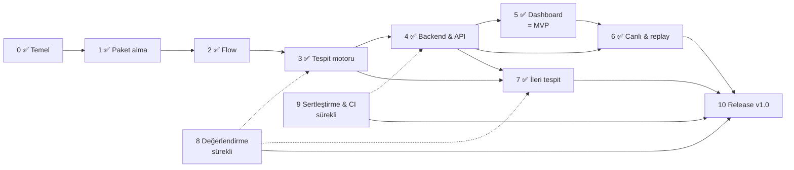

# NetGuard Yol Haritası

> Son güncelleme: **2026-10-27** · Mevcut sürüm: **v0.8.0** (aday: **1.0.0rc1**, etiketlenmedi) · Aktif faz: **Faz 10 — Release hazırlığı** (👤 kalan Faz 8 lab koşuları bekliyor)
>
> Bu dosya projenin **tek** yol haritasıdır. Güncel iş listesi
> [docs/TASKS.md](docs/TASKS.md), ölçülmüş sonuçlar
> [docs/EVALUATION.md](docs/EVALUATION.md), mimari kararlar [docs/adr/](docs/adr/)
> altındadır.

Durum: ✅ tamamlandı · 🔄 devam ediyor · ⏳ başlanmadı · 👤 kullanıcı gerekli
(fiziksel lab, hesap ayarı veya yayın onayı).

---

## 1. Ürün vizyonu ve kapsam

**NetGuard**, ağ trafiğini (pcap/pcapng, kontrollü canlı yakalama) analiz eden,
paket/bağlantı/protokol özelliklerini çıkaran, şüpheli davranışı
**açıklanabilir kurallarla** tespit eden, her alarmı kanıtıyla birlikte
yapılandırılmış olarak üreten ve sonuçları bir web dashboard'da gösteren bir
ağ güvenliği izleme ve analiz platformudur.

**NetGuard'ı farklı kılan:**

1. **Açıklanabilirlik:** her alarm ne görüldüğünü, hangi eşiğin aşıldığını,
   saldırganın ne öğrendiğini ve ATT&CK karşılığını söyler. Kesinlik yerine
   kanıtın desteklediği ifade kullanılır ("possible ARP spoofing").
2. **Ölçülebilirlik:** tespit kalitesi etiketli senaryolar ve lab yakalamalarıyla
   ölçülür, sonuçlar (yanlış pozitifler dahil) yayınlanır.
3. **Saldırgan girdiye dayanıklılık:** her bayt düşmanca kabul edilir, tüm
   durum (state) sınırlıdır, sınır işlemleri O(1)'dir.
4. **Okunabilirlik:** küçük, test edilmiş, belgelenmiş bir kod tabanı.

**Kapsam dışı (bilinçli olarak):** satır hızında (10 Gbit/s) yakalama, inline
engelleme (IPS), imza tabanlı exploit tespiti, tam protokol ayrıştırma. Bunları
Zeek ve Suricata zaten iyi yapıyor; NetGuard onlarla özellik özellik yarışmaz,
ileride onların çıktılarını ek girdi olarak okuyabilir.

**Donanım hedefi:** MacBook Air M1 (geliştirme), Kali (UTM, saldırgan), ~4 GB
RAM'li Ubuntu sunucu (kurban / dağıtım hedefi). Bulut, ücretli API ve
mikroservis yok.

## 2. Mevcut durum (2026-10-27)

| Faz | Konu | Durum | Sürüm |
|---|---|---|---|
| 0 | Araştırma, mimari, temel | ✅ | v0.1.0 |
| 1 | Paket alma ve protokol analizi | ✅ | v0.1.0 + v0.2.0 |
| 2 | Flow ve özellik çıkarımı | ✅ | **v0.2.0** |
| 3 | Tespit motoru (genişletme) | ✅ | **v0.3.0** |
| 4 | Backend, kalıcılık, API | ✅ | **v0.4.0** |
| 5 | Web dashboard | ✅ | **v0.5.0 = MVP** |
| 6 | Canlı yakalama ve replay | ✅ (👤 lab doğrulaması) | **v0.6.0** |
| 7 | İleri tespit ve tehdit istihbaratı | ✅ | **v0.7.0** |
| 8 | Test, benchmark, değerlendirme | 🔄 ilk gerçek ölçümler var · 👤 kalan lab koşuları | 1.0.0rc1 |
| 9 | Güvenlik sertleştirme ve CI/CD | ✅ | **v0.8.0** |
| 10 | Dokümantasyon, release, portföy | 🔄 aday hazır · 👤 inceleme, merge ve etiket kararı | **1.0.0rc1** aday; v1.0.0 lab'den sonra |

**Ölçülmüş durum (1.0.0rc1 adayı):** 11 tespit kuralı, güven puanı ve korelasyon,
REST API, web dashboard, canlı yakalama; 425 Python testi (3.11–3.14) ve 14
frontend testi, kapsama %93; ruff, mypy `--strict`, TypeScript strict temiz;
bilinen açığı olan bağımlılık yok (pip-audit, pnpm audit). Yazılı tehdit
modeli ([THREAT_MODEL.md](docs/THREAT_MODEL.md)); kurulum temiz ortamda ve
Ubuntu 26.04 ARM64 container'ında doğrulandı, Linux'ta canlı yakalama
(loopback) ve worker bellek sınırı gerçek olarak çalıştı.

**Gerçek trafikte ilk ölçümler (2026-10-27, izole UTM lab):** iki SYN taraması
(biri canlı yakalama) ve bir saatlik düşük hızlı normal trafik. Taramada iki
tarama kuralı beklenen varlıkla tetiklendi; normal trafikte canlıda ve
offline'da 0 alarm, 0 kernel kaybı, en yüksek RSS 34,0 MiB; flow durumları
Zeek 8.2.2 ile eşit (bkz. [EVALUATION.md § 6](docs/EVALUATION.md)). Bu, aracın
genel doğruluğu değildir: tek saldırı türü ve tek normal trafik karışımı.
Ardından lab köprüsüyle sekiz deney daha koştu (connect/Xmas/FIN/NULL, UDP,
ping taraması, fragment taraması, SYN burst): her biri yalnız beklenen alarmı
verdi. NULL/FIN/Xmas yakalamaları bir flow durumu hatası buldu (SYN'siz
bağlantılar hep `OTH`'du; Zeek `RSTRH`/`RSTR`/`SH` diyor), düzeltildi ve
Zeek ile eşit. Fragment taramasındaki fark tasarım sınırıdır (IP fragment
birleştirme yok). Sonra yavaş tarama, ARP, DNS ve canlı erken uyarı da
ölçüldü: her biri yalnız beklenen alarmı verdi; canlıda erken uyarı eşiği
geçiren paketten 0,68-0,76 s sonra raporlandı (tek koşu). Baseline deneyi
(exp14) ilk koşuda 9945 kernel kaybıyla başarısız sayıldı; tekrar koşusu
(r02) 0 kayıpla NG-RATE-001 ve NG-VOL-001'i verdi. 11 kuralın her biri artık
en az bir gerçek lab yakalamasında beklenen varlıkla tetiklendi (17 kabul
edilen yakalama, deney başına tek koşu; doğruluk oranı değildir).

## 3. Fazlar arası bağımlılık

Faz 8 ve 9 her fazda sürekli yürütülür (her dedektör senaryo ve testle gelir,
her değişiklik CI'dan geçer); kendi fazlarında eksikler toplanıp tamamlanır.

**MVP (v0.5.0):** pcap yükle → analiz et → flow'ları, istatistikleri ve
kanıtlı alarmları dashboard'da incele → rapor/olay dışa aktar. Tüm tespitler
sentetik senaryolarda ölçülmüş, sınırlamalar belgelenmiş.

## 4. Çalışma yöntemi

Her faz için: gereksinim ve bağımlılık gözden geçirme → işlere bölme →
uygulama → test → hata düzeltme → doküman → commit/push → kabul kriterleri
karşılanınca faz kapanışı.

Her önemli algoritma ve güvenlik mekanizması için bir **öğrenme kontrol
noktası** vardır: problem, çözüm, neden bu çözüm, alternatifler, karmaşıklık,
sınırlamalar ve kısa deney/sorular. Bunlar `docs/learning/NN-*.md` (Türkçe)
notlarında toplanır.

Kurallar: her yeni dedektör bir saldırı senaryosu, bir **benign benzeri**
senaryo ve birim testlerle gelir; performans gerilemesi %20'yi geçemez;
ölçülmemiş sonuç yazılmaz; büyük kararlar ADR ile belgelenir.

---

## 5. Fazlar

### Faz 0 — Araştırma, mimari ve temel ✅

Kapsam analizi, Python + dpkt seçimi ([ADR-0001](docs/adr/0001-python-and-dpkt.md)),
canlı yakalamanın `tcpdump`'a devri ([ADR-0002](docs/adr/0002-capture-via-tcpdump.md)),
incident birleştirme ([ADR-0003](docs/adr/0003-incident-aggregation.md)), `uv`,
ruff, mypy `--strict`, pytest, CI (Linux/macOS × Python 3.11–3.13), MIT lisansı,
AI co-author trailer'larını reddeden `commit-msg` hook'u, SSH imzalı commit'ler.

### Faz 1 — Paket alma ve protokol analizi ✅

| # | İş | Durum |
|---|---|---|
| 1.1 | pcap/pcapng okuma, stdin dahil seek edilemeyen akışlar | ✅ v0.1 |
| 1.2 | Decoder: Ethernet, Linux SLL, BSD loopback, raw IP; IPv4/IPv6; TCP/UDP/ICMP/ICMPv6/ARP; DNS sorgu adı | ✅ v0.1 |
| 1.3 | Bozuk paketler sayılır, hata fırlatılmaz; fuzz testi | ✅ v0.1 |
| 1.4 | CLI: `analyze` (text/JSON/JSONL), `lab` | ✅ v0.1 |
| 1.5 | **Kendi pcap/pcapng okuyucuları:** çok arayüzlü pcapng (arayüz başına link tipi, `if_tsresol`), uzunluk alanı sınırları, kesik dosya raporlama ([ADR-0005](docs/adr/0005-own-capture-readers-and-fast-decoder.md)) | ✅ v0.2 |
| 1.6 | Decoder: TCP seq/ack, payload uzunluğu (IP uzunluğundan, snaplen'e dayanıklı), TTL, IP fragment işareti | ✅ v0.2 |
| 1.7 | `struct` tabanlı hızlı decode yolu + dpkt ile diferansiyel fuzz testi | ✅ v0.2 |
| 1.8 | Paket boyutu dağılımı, desteklenmeyen link tipi sayacı | ✅ v0.2 |

**Kabul kriterleri:** ✅ bozuk girdiyle çökmeme (fuzz), ✅ sınırlı bellek (düşmanca
uzunluk alanları testli), ✅ çok arayüzlü pcapng testli, ✅ CLI testli.

**Bilinen sınırlama:** IP fragment birleştirme yok (fragment'lar işaretlenir ve
sayılır); IPv6 extension header'lı paketlerde payload uzunluğu yakalanan
bayttan hesaplanır.

### Faz 2 — Flow ve özellik çıkarımı ✅ (v0.2.0)

| # | İş | Durum |
|---|---|---|
| 2.1 | Çift yönlü flow, originator tespiti (SYN-ACK ile yön düzeltme) | ✅ |
| 2.2 | Yön bazlı paket/bayt/payload sayaçları, süre, TCP bayrak birikimi, Zeek tarzı `history` | ✅ |
| 2.3 | Zeek uyumlu `conn_state` (S0, S1, SF, REJ, S2, S3, RSTO, RSTR, RSTOS0, RSTRH, SH, SHR, OTH) | ✅ |
| 2.4 | Retransmission ve sequence gap tespiti (RFC 1982 serial aritmetik) | ✅ |
| 2.5 | Zaman aşımı sınıfları ve O(1) expiry; port yeniden kullanımı; LRU eviction ([ADR-0004](docs/adr/0004-flow-semantics.md)) | ✅ |
| 2.6 | Dedektörlere `on_flow_end(flow)` kancası | ✅ |
| 2.7 | `netguard flows -f csv\|jsonl` | ✅ |
| 2.8 | İstatistikler: flow durum dağılımı, servisler, en büyük flow'lar, uyarlanabilir zaman serisi, sınırlı endpoint tablosu | ✅ |
| 2.9 | Alarm modeli v1: `rule_id`, deterministik `alert_id`, `schema_version`; sözleşme testi; [kural kataloğu](docs/rules/README.md) | ✅ |
| 2.10 | Tracker DoS düzeltmesi: dolu tabloda O(n) GC → O(1) LRU; anahtar başına bellek 1 996 → 668 bayt | ✅ |
| 2.11 | Gerçek lab yakalamasında `nmap -sS` durum dağılımı, Zeek `conn.log` karşılaştırması | 👤 Faz 8'e taşındı |

**Kabul kriterleri:** ✅ `flows` komutu çalışıyor, ✅ her TCP durumu el yapımı
paket dizisiyle test edildi, ✅ tüm alarmlarda `rule_id`/`schema_version`,
✅ performans gerilemesi yok (v0.1'den ~1,6× hızlı), ✅ sentetik sonuçlar v0.1
ile aynı (bilinçli incident düzeltmesi hariç). Lab doğrulaması 👤 Faz 8'de.

**Öğrenme notu:** [02 — Paketten bağlantıya](docs/learning/02-flows-and-tcp-state.md).

### Faz 3 — Tespit motoru ✅ (v0.3.0)

**Amaç:** istenen tespit kategorilerinin tamamını, her biri için gözlenebilir
davranış, mantık, eşik, kanıt, test ve FP/FN belgesiyle tamamlamak.

| # | İş | Kural | Durum |
|---|---|---|---|
| 3.1 | DNS ayrıştırıcı (`dns.py`): başlık, `rcode`, `qtype`, yanıtlar; sıkıştırma döngüsüne dayanıklı | — | ✅ |
| 3.2 | **TRW tarama dedektörü** (Jung vd., 2004), bağlantı olayları; pencere kuralı sonuca duyarlı (`max_open_ratio`) ([ADR-0006](docs/adr/0006-connection-events-and-outcome-aware-scans.md)) | NG-SCAN-002 | ✅ |
| 3.3 | UDP tarama (ICMP port unreachable, yanıt veren portlar) | NG-SCAN-003 | ✅ |
| 3.4 | Yavaş tarama | NG-SCAN-002 (TRW, 1 saatlik ufuk) | ✅ |
| 3.5 | **SYN flood:** hedef başına tamamlanmayan el sıkışmalar | NG-SYN-001 | ✅ |
| 3.6 | ICMP anomalileri | NG-SWEEP-001 (ICMP sweep) mevcut; ICMP tünel/payload kuralı Faz 7'ye ertelendi | 🔶 kısmi |
| 3.7 | DNS anomalileri: tünelleme, NXDOMAIN/DGA | NG-DNS-001, NG-DNS-002 | ✅ (onaysız resolver politikası Faz 7'ye) |
| 3.8 | Olağan dışı bağlantı sıklığı (host başına EWMA baseline, [ADR-0007](docs/adr/0007-per-host-baselines.md)) | NG-RATE-001 | ✅ |
| 3.9 | Olağan dışı trafik hacmi | NG-VOL-001 | ✅ |
| 3.10 | Parçalama ile atlatma (RFC 1858, `nmap -f`) | NG-FRAG-001 | ✅ |
| 3.11 | Her kural için saldırı + benign benzeri senaryo + kural sayfası | — | ✅ (24 senaryo, 11 sayfa) |
| 3.12 | `netguard rules`, kural bazında aç/kapa ve eşikler, ayarlanabilir `max_keys`, örnek config = varsayılanlar testi | — | ✅ |

**Kabul kriterleri:** ✅ brief'teki her kategori için en az bir kural; ✅ her
kural saldırı ve benign benzeri senaryoda test edildi; ✅ kural sayfaları
FP/FN ve ayar önerisi içeriyor; ✅ skor tablosu güncel; ✅ şüphe ifadesi kanıta
uygun ("possible …"); ✅ performans bütçesi (%20) içinde. Gerçek trafikte
doğrulama 👤 Faz 8'de.

**Öğrenme notları:** [03 — TRW ve ardışık hipotez testi](docs/learning/03-trw-and-sequential-testing.md),
[04 — DNS, baseline'lar ve parçalama](docs/learning/04-dns-baselines-fragments.md).

### Faz 4 — Backend, kalıcılık ve API ✅ (v0.4.0)

| # | İş | Durum |
|---|---|---|
| 4.1 | Teknoloji kararı: SQLite (WAL) + FastAPI opsiyonel `netguard[web]` eki, analiz ayrı süreçte ([ADR-0008](docs/adr/0008-backend-storage-and-api.md)) | ✅ |
| 4.2 | Şema: `captures`, `analyses` (yapılandırma anlık görüntüsü dahil), `alerts`, `flows`; sürümlü migrasyon. Kurallar koddan sunuluyor; düzenlenebilir kural profilleri Faz 5'te | ✅ |
| 4.3 | İş yaşam döngüsü: `queued → running → done/failed/cancelled`, iptal, zaman aşımı, bellek/CPU sınırı, yeniden başlatmada kurtarma | ✅ |
| 4.4 | API v1: yükleme (akışta boyut sınırı, magic kontrolü, tekilleştirme), analiz, flow/alarm arama, sıralama, filtreleme, sayfalama; OpenAPI | ✅ |
| 4.5 | Olay şeması: native sözleşme + Elastic Common Schema (ECS) NDJSON dışa aktarımı | ✅ |
| 4.6 | Entegrasyon testleri (19 API, 10 store/job), güvenli varsayılanlar (loopback, token, `0700`/`0600`) | ✅ |

**Kabul kriterleri:** ✅ entegrasyon testleri gerçek HTTP katmanı, SQLite ve
worker süreçleriyle geçiyor; ✅ OpenAPI şeması yayınlanıyor; ✅ bozuk/düşmanca
yakalama işi temiz bir hata ile bitiriyor, sunucu yolu sızdırmıyor; ✅ canlı
`uvicorn` ile uçtan uca denendi (yükleme → analiz → alarm → ECS).

**Bilinen sınırlamalar:** tek düğüm (birden çok API süreci için farklı iş
sahiplenme gerekir); macOS'ta worker bellek sınırı uygulanmıyor; TLS yok
(reverse proxy ile sağlanmalı); metin araması `LIKE`.

**Öğrenme notu:** [05 — Düşmanca dosyaları kabul eden backend](docs/learning/05-backend-security.md).

### Faz 5 — Web dashboard ✅ (v0.5.0 = MVP)

| # | İş | Durum |
|---|---|---|
| 5.1 | Teknoloji kararı: React + TypeScript + Vite SPA, API tarafından sunuluyor, sıkı CSP ([ADR-0009](docs/adr/0009-dashboard-stack.md)) | ✅ |
| 5.2 | Güvenlik özeti, trafik istatistikleri, zaman serisi, protokol/bağlantı durumu/servis dağılımı, endpoint'ler, en büyük flow'lar, flow tarayıcısı (filtre, sıralama, sayfalama) | ✅ |
| 5.3 | Alarm akışı (URL'de saklanan filtreler), alarm detayı ve kanıt görünümü, ilgili flow'lar, ATT&CK ve kural sayfası bağlantıları | ✅ |
| 5.4 | Yükleme (ilerleme çubuğu, sürükle-bırak), canlı iş durumu, iptal; yükleme/boş/hata durumları, 401'de token yönlendirmesi | ✅ |
| 5.5 | Kural profilleri (API + düzenleyici, yalnız farklar saklanıyor), profil ile yeniden analiz; HTML rapor, NDJSON/ECS ve CSV dışa aktarımı | ✅ |
| 5.6 | XSS testleri (frontend ve HTML rapor), CI'da satır içi script kontrolü, path traversal testi; yalnızca gerçek veri | ✅ |

**Kabul kriterleri:** ✅ yakalama yükle → analiz et → istatistik, flow ve
kanıtlı alarmları dashboard'da incele → rapor/dışa aktar akışı gerçek sunucuda
tarayıcıda denendi; ✅ düşmanca dizeler metin olarak gösteriliyor; ✅ mobil
genişlikte yatay kaydırma yok; ✅ sahte veri yok.

**Tarayıcıda bulunan ve düzeltilen hatalar:** çubuk grafiklerin sütun
genişliği; `v` bayraklı regex'te geçersiz `pattern` özniteliği (istemci
doğrulaması sessizce devre dışıydı; sunucu doğrulaması her zaman geçerliydi).

**Bilinen sınırlamalar:** ekran görüntüleri ve demo Faz 10'da; dashboard
erişilebilirliği otomatik olarak denetlenmedi (manuel: klavye odağı, ARIA
etiketleri, tablo eşdeğerleri); bundle'ı Python paketine koyan release adımı
Faz 9/10'da.

**Öğrenme notu:** [06 — Saldırgan kontrollü veriyi gösteren arayüz](docs/learning/06-dashboard-security.md).

### Faz 6 — Canlı yakalama ve replay ✅ (v0.6.0)

| # | İş | Durum |
|---|---|---|
| 6.1 | `netguard monitor`: tek ve açıkça adlandırılmış arayüzde `tcpdump`, BPF filtresi, süre/paket sınırı, sınırlı kuyruk, `--write` (0600, boyut sınırı), Ctrl-C ile temiz kapanış, çekirdek düşürme istatistiği ([ADR-0010](docs/adr/0010-live-capture-and-alert-lifecycle.md)) | ✅ |
| 6.2 | Yetki modeli: NetGuard root olarak çalışmayı reddediyor; Linux `setcap`, macOS BPF erişimi, `--sudo` (`sudo -n … -Z kullanıcı`); izin hatasında platforma özel açıklama ([LIVE_CAPTURE.md](docs/LIVE_CAPTURE.md)) | ✅ |
| 6.3 | `netguard replay --speed N`; farklı profillerle yeniden analiz (Faz 5) | ✅ |
| 6.4 | Alarm yaşam döngüsü: `early`/`final` aşamaları, `reported_at`, `max_incident_age`, sessizlikte saat ilerletme (`Engine.advance`); şema 1.1 | ✅ |
| 6.5 | Canlı = offline doğrulaması gerçek arayüzde, soak testi, paket kaybı ölçümü | 👤 lab (bu makinede yakalama yetkisi yok) |

**Kabul kriterleri:** ✅ replay'in final alarmları offline analizle birebir
aynı (test); ✅ canlı boru hattı uçtan uca test edildi (tcpdump yerine
betik kaynak); ✅ gerçek tcpdump izin hatası doğru açıklandı; ✅ tespit
gecikmesi ölçüldü ve belgelendi. 👤 Gerçek arayüzde canlı yakalama lab'de
doğrulanacak.

**Bilinen sınırlamalar:** canlı yakalamayı dashboard'dan başlatmak bilinçli
olarak yok (API sürecine yetkili yakalama başlatma gücü vermemek için);
`monitor` sonuçları veritabanına doğrudan yazılmıyor (`--write` ile kaydedilen
pcap yüklenebilir); IPv6 parça birleştirme yok.

**Öğrenme notu:** [07 — Canlı trafik: yetki, zaman ve gecikme](docs/learning/07-live-capture.md).

### Faz 7 — İleri tespit ✅ (v0.7.0)

Adaylar ölçülebilir değere göre seçildi ([ADR-0011](docs/adr/0011-phase-7-feature-selection.md)):

| # | İş | Karar / durum |
|---|---|---|
| 7.1 | Alarm korelasyonu: aktör ve zamana göre olaylar, ATT&CK taktikleri (`correlate.py`, API, dashboard, rapor) | ✅ (ör. 4 alarm → 1 olay, 3 taktik) |
| 7.2 | Açıklanabilir güven puanı: kural tabanı + gerekçeli faktörler, 5–95 ([CONFIDENCE.md](docs/CONFIDENCE.md)), sözleşme 1.2 | ✅ (YP'ler 25–30, DP'ler 45–95; tutarlılık kontrolü) |
| 7.3 | DHCP kira korelasyonu: güvenilen sunucunun ACK'i ARP değişikliğini açıklar; sahte DHCP sunucusu açıklayamaz | ✅ |
| 7.4 | Profil içe/dışa aktarma (TOML), `netguard config` | ✅ |
| 7.5 | Zeek `conn.log` / Suricata EVE girdisi | ⏸ v1.x (ölçecek veri yok) |
| 7.6 | ICMP tünel kuralı, onaysız resolver politikası, mevsimsel baseline | ⏸ ertelendi (gerekçe ADR-0011) |
| — | Makine öğrenmesi | ✗ şimdilik reddedildi (etiketli gerçek veri yok, açıklanamaz) |

**Kabul kriterleri:** ✅ her özellik için ölçüm EVALUATION.md'de; ✅ sınırlamalar
belgelendi (TOFU, IP/MAC aktör ayrımı, tutarlılık kontrolü ≠ doğruluk).

**Öğrenme notu:** [08 — Alarmdan karara](docs/learning/08-confidence-correlation.md).

### Faz 8 — Test, benchmark ve değerlendirme 🔄 sürekli · 👤 lab

| # | İş | Durum |
|---|---|---|
| 8.1 | Etiketli sentetik senaryolar, `lab evaluate`, CI'da skor tablosu | ✅ |
| 8.2 | Tekrarlanabilir benchmark'lar (`benchmarks/`), flood bellek testi | ✅ v0.2 |
| 8.3 | UTM lab: Kali → Ubuntu, izole host-only ağ ([LAB_SETUP.md](docs/LAB_SETUP.md)) | ✅ (kullanıcı kurdu) |
| 8.4 | Saldırı yakalamaları ve ≥ 1 saat benign trafik | 🔶 SYN taraması ×2 ve 1 saat benign tamam; kalan deneyler 👤 ([eval/lab/RUN.md](eval/lab/RUN.md)) |
| 8.5 | Yakalama manifestosu (`eval/captures.toml`: sha256, araç, komut, beklenen alarm); `lab evaluate --manifest`; gerçek pcap gerileme testi (`eval/lab/real_regression.py`) | ✅ |
| 8.6 | Precision/recall, benign trafikte saat başına alarm, tespit gecikmesi; açık veri setleri (lisansına uygun) | 🔶 tek benign saat 0 alarm; precision/recall ve canlı erken uyarı gecikmesi kalan koşulara bağlı |
| 8.7 | Kesilen iş, bozuk girdi, uzun çalışma senaryoları | ⏳ |

### Faz 9 — Güvenlik sertleştirme ve CI/CD ✅ (v0.8.0)

| # | İş | Durum |
|---|---|---|
| 9.1 | Tüm girdi yolları için tehdit modeli ([THREAT_MODEL.md](docs/THREAT_MODEL.md)); 7 bulgu düzeltildi: DNS rebinding, çapraz-site yazma, sınırsız JSON gövdesi, disk/kuyruk tükenmesi, `--write` symlink izleme, WAL dosya izinleri, Python 3.14 broken-pipe | ✅ |
| 9.2 | Bağımlılık denetimi (pip-audit, pnpm audit: açık yok), lisans envanteri (hepsi izin verici), CycloneDX SBOM | ✅ |
| 9.3 | CI: `security` işi (pip-audit, lisans kapısı, haftalık), Python 3.14 matrisi; tag ile çalışan release iş akışı (dashboard derleme, temiz ortamda wheel testi, SBOM, checksum, **taslak** release) | ✅ (release iş akışı ilk tag'de çalışacak) |
| 9.4 | Temiz ortamda kurulum: macOS venv ve Ubuntu 26.04 ARM64 container (kurulum, analiz, sunucu, bellek sınırı, setcap ile canlı yakalama) | ✅ |
| 9.5 | Dağıtım: sertleştirilmiş systemd unit (`systemd-analyze` 1,6 "OK"), Caddy TLS örneği, [DEPLOYMENT.md](docs/DEPLOYMENT.md) | ✅ (gerçek sunucuda systemd ile çalıştırma 👤) |

**Öğrenme notu:** [09 — Sertleştirme](docs/learning/09-hardening.md).

### Faz 10 — Dokümantasyon, release ve portföy ⏳ (v1.0.0)

Kod kalitesi incelemesi, mimari ve operasyon dokümanları, kurulum ve
geliştirici rehberi, gerçek demo ve ekran görüntüleri, desteklenen protokoller
ve tespit sınırlamaları, mühendislik değerlendirme raporu, CHANGELOG ve
release notları, GitHub release'i (👤 yayın onayı), LinkedIn portföy metni
taslağı.

**v1.0 tamamlanma tanımı:** brief'teki "Definition of Done" maddelerinin
hepsi kanıtla karşılanmış; karşılanamayan madde varsa açıkça yazılır ve tam
uyum iddia edilmez.

**Durum (2026-10-27):** 10.1–10.4, 10.6–10.8 tamam. `1.0.0rc1` adayı
`fix/audit-2026-10-27` dalında (PR #9; PR #8'i içerir) hazır, etiketlenmedi.
Kontrol listesi ([RELEASE_CHECKLIST.md](docs/RELEASE_CHECKLIST.md)): 12
maddeden 8'i karşılandı, 4'ü kısmen (flow doğrulaması, canlı yakalama,
ölçülmüş sınırlar, release artefaktları). Release kapıları etiketsiz
`release-dryrun.yml` ile GitHub'da çalıştı; etiketle tetiklenen iş akışı henüz
çalışmadı. Teslim raporu: [DELIVERY_REPORT.md](docs/DELIVERY_REPORT.md).

**Dış denetim (2026-10-27):** bağımsız bir inceleme, testlerin kaçırdığı dört
kusuru yeniden üretti: eşzamanlı yüklemelerde kota aşımı, portu karşılaştırmayan
Origin kontrolü, canlı oturumda sınırsız alarm geçmişi ve sınırı aşabilen zaman
serisi. Release sürecinde de üç eksik buldu: etiketlenen kaynak yeniden test
edilmiyordu, kurulan bağımlılıklar SBOM ile eşleşmiyordu ve sdist eksikti.
Hepsi `fix/audit-2026-10-27` dalında regresyon testleriyle düzeltildi. Aynı dalda
gerçek yakalama değerlendirmesi için manifesto ve Zeek karşılaştırma araçları ile
lab kabul ölçütleri de hazırlandı. Lab sonuçları hâlâ yok.

---

## 6. Teknoloji kararları

| Alan | Karar | Durum |
|---|---|---|
| Dil | Python 3.11+ (okunabilirlik, test edilebilirlik; performans ölçülerek yönetiliyor) | ADR-0001 |
| Paket ayrıştırma | Kendi pcap/pcapng okuyucuları + `struct` hızlı yol + dpkt yedek | ADR-0005 |
| Canlı yakalama | `tcpdump` alt süreci, sınırlı kuyruk, saat ilerletme, erken uyarı; NetGuard root çalışmaz | ADR-0002, ADR-0010 |
| Alarm modeli | Incident birleştirme, `rule_id`, deterministik `alert_id`, şema 1.0 | ADR-0003 |
| Flow modeli | Zeek `conn_state` sözlüğü, zaman aşımı sınıfları, LRU | ADR-0004 |
| Sonuca duyarlı tespit | Bağlantı olayları, TRW + pencere kuralı, protokol bazlı dağıtım | ADR-0006 |
| Anomali baseline'ları | Host başına EWMA ortalama + mutlak sapma, kırpma | ADR-0007 |
| Depolama | SQLite, WAL, sürümlü migrasyon | ADR-0008 |
| API | FastAPI (opsiyonel `web` eki), analiz izole worker süreçlerinde | ADR-0008 |
| Dashboard | React + TypeScript + Vite SPA, API'den sunuluyor, sıkı CSP | ADR-0009 |

## 7. Test stratejisi

| Seviye | Ne | Araç | Ne zaman |
|---|---|---|---|
| Birim | Decoder, okuyucular, flow durumları, pencereler, dedektörler | pytest, el yapımı `Packet`/frame | Her commit (CI) |
| Diferansiyel | Hızlı decode yolu = dpkt yolu | 5 000 mutasyonlu frame | Her commit |
| Senaryo | Saldırı + benign benzeri; TP/FP/FN sabitlenmiş | `lab/scenarios.py` | Her commit |
| Dayanıklılık | Bozuk frame/dosya, düşmanca uzunluklar, flood bellek | `test_decode`, `test_formats`, `benchmarks/` | Her commit / release |
| Gerçek yakalama | Gerçek araç davranışı, benign FP oranı | Manifesto + yerel pcap'ler (git dışı) | Dedektör değişikliklerinde 👤 |
| Performans | Throughput, RSS; gerileme < %20 | `benchmarks/make_bench_pcap.py` | Her faz sonu |
| API/Web | Sözleşme, yükleme güvenliği, XSS | `TestClient` | Faz 4–5'ten itibaren |

Kapsama eşiği %90 (CI'da zorunlu). Gerçek pcap'ler git'e girmez (`.gitignore`).

## 8. Bilinen sorunlar

| Sorun | Etki | Hedef |
|---|---|---|
| DHCP görünmüyorsa tek ARP bağlama değişikliği alarm üretiyor | `dhcp_reassignment` FP (düşük güven); DHCP görünürse açıklanıyor | Sensör yerleşimi |
| İzleme sunucusu ping sweep gibi görünüyor | `monitoring_poller` FP (allowlist; düşük güven) | Allowlist |
| Yanlış DNS arama son eki DGA gibi görünüyor | `search_suffix_nxdomain` FP (düşük güven) | Allowlist / yapılandırma |
| Saldırgan IP ve MAC ile iki ayrı aktör | Tarama (IP) ve ARP (MAC) alarmları iki olay | v1.x (IP↔MAC eşleme) |
| Baseline kuralları ısınma istiyor | 10 dakikadan kısa yakalamalarda hız/hacim alarmı yok; baseline analizler arasında saklanmıyor | Ertelendi (ADR-0011) |
| Decoy/sahte kaynaklı taramalar | Bir tarama birçok kaynağa bölünüyor | Açık (korelasyon aktöre göre, hedefe göre değil) |
| Sahte kaynaklı flood | Kaynak bazlı dedektör tabloları taşıyor, flood içindeki gerçek bir tarama kaçabilir | Faz 10'dan beri çıktıda raporlanıyor |
| IP fragment birleştirme yok | Parçalı probe'lar analiz edilmiyor; NG-FRAG-001 atlatmayı raporluyor | Lab verisi gerektirirse |

## 9. Kullanıcı gerektiren işler 👤

- Kalan lab koşuları (8.4, 8.11c, 8.12, 8.13): [eval/lab/RUN.md](eval/lab/RUN.md);
  yalnızca sahip olunan, izole ağda.
- PR #8 ve #9'un incelenip birleştirilmesi, `v1.0.0rc1` etiketi.
- GitHub: repo görünürlüğünü değiştirmek (şu an private), release yayınlamak.
- Canlı yakalama testleri için yetkili arayüz seçimi ve `sudo`.

## 10. Bu dosyanın bakımı

- İş bitince durum burada, ayrıntı [docs/TASKS.md](docs/TASKS.md)'de güncellenir.
- Faz bitince §2 ve değişiklik kaydı güncellenir, CHANGELOG'a sürüm eklenir.
- Plan değişirse nedeni bir satırla aşağıya yazılır; mimari etkisi varsa ADR açılır.

### Değişiklik kaydı

- **2026-10-27:** Dış denetim düzeltmeleri, ilk gerçek lab ölçümleri (exp01,
  live-syn-01, benign-01) ve Zeek ile flow durumu uyumu (FIN/RST sırası, iki
  taraflı RST). Kalan deneyler için sınırlı lab paketi. Sürüm `1.0.0rc1`
  adayına çekildi (etiket yok); v0.9.0 ayrı bir sürüm olarak çıkmayacak.

- **2026-10-22:** Faz 9 tamamlandı ve v0.8.0 olarak yayına hazırlandı. Sürüm
  numaraları artık faz numarasını değil yayın sırasını izliyor: Faz 8 (lab
  değerlendirmesi) kullanıcı yakalamalarını beklediği için v0.9.0'a kaldı.
- **2026-10-22:** Faz 7 tamamlandı (v0.7.0): güven puanı, korelasyon, DHCP
  kira korelasyonu, profil TOML içe/dışa aktarma. Zeek/Suricata girdisi ve ML
  ölçülebilir değer gösterilene kadar ertelendi.
- **2026-10-22:** Faz 6 tamamlandı (v0.6.0): `monitor`, `replay`, erken uyarı,
  azami incident yaşı, tespit gecikmesi ölçümü. Gerçek arayüzde doğrulama 👤 lab.
- **2026-10-22:** Faz 5 tamamlandı (v0.5.0 = MVP): web dashboard, kural
  profilleri, HTML rapor, CSV/ECS dışa aktarımı.
- **2026-10-22:** Faz 4 tamamlandı (v0.4.0): SQLite depolama, iş yaşam
  döngüsü, izole worker süreçleri, REST API v1, ECS dışa aktarımı.
- **2026-10-22:** Faz 3 tamamlandı (v0.3.0): 8 yeni kural (TRW, UDP tarama,
  SYN flood, DNS tünelleme, NXDOMAIN/DGA, parçalama, bağlantı sıklığı, hacim).
  ICMP tünel kuralı ve onaysız resolver politikası ölçülebilir değer
  gösterilene kadar Faz 7'ye ertelendi.
- **2026-10-22:** Yol haritası, proje brief'indeki 0–10 faz yapısına göre
  yeniden düzenlendi. Eski Faz 2 (lab) → Faz 8; eski Faz 3 (flow) → Faz 2;
  eski Faz 4–5 (tarama, SYN flood, DNS, hacim) → Faz 3; eski Faz 6–7 (rapor,
  API, dashboard) → Faz 4–5; eski Faz 8 (canlı) → Faz 6; eski Faz 9–10 →
  Faz 7. MVP, dashboard dahil olacak şekilde v0.5.0 olarak yeniden tanımlandı.
  Faz 2 tamamlandı (v0.2.0).
- **2026-10-21:** Yol haritası Türkçe olarak yeniden yazıldı, mevcut durum analizi eklendi.
- **2026-10-20:** Faz 0–1 tamamlandı (v0.1.0).
