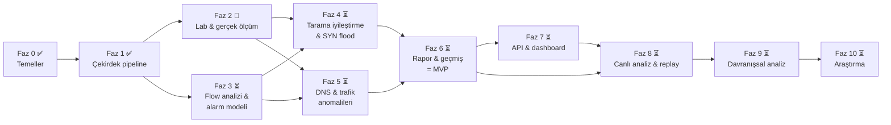

# NetGuard Yol Haritası

> Son güncelleme: **2026-10-21** · Mevcut sürüm: **v0.1.0** · Aktif faz: **Faz 2**
>
> Bu dosya projenin **tek** yol haritasıdır. Güncel iş listesi
> [docs/TASKS.md](docs/TASKS.md), ölçülmüş sonuçlar
> [docs/EVALUATION.md](docs/EVALUATION.md) dosyasındadır.

Durum işaretleri: ✅ tamamlandı · 🔄 devam ediyor · ⏳ başlanmadı ·
Efor: **S** (birkaç oturum) · **M** (1–2 hafta) · **L** (2+ hafta), yarı zamanlı
çalışma varsayımıyla.
Sahiplik: **F** = Furkan (öğrenme açısından kritik, kendi elinle) · **C** = birlikte.

---

## 1. Amaç ve kapsam

**Amaç:** Ağ trafiğini (pcap/pcapng dosyaları, ileride canlı akış) analiz eden,
şüpheli aktiviteleri tespit eden ve her tespiti **teknik gerekçesiyle**
açıklayan bir Network IDS ve trafik analizörü. NetGuard'ı farklı kılan,
alarmların *ne görüldüğünü, hangi eşiğin aşıldığını, saldırganın ne
öğrendiğini/ne yapmaya çalıştığını* ve MITRE ATT&CK karşılığını söylemesi ve
tespit kalitesinin **ölçülerek** yayınlanmasıdır.

**Kapsam içi:**

- Offline pcap/pcapng analizi; `tcpdump` üzerinden canlı akış analizi
- Flow (akış) analizi ve trafik istatistikleri
- Keşif (port tarama, host sweep), SYN flood, DNS anomalileri, L2 saldırıları
  (ARP spoofing) ve olağan dışı trafik davranışının tespiti
- Kural tabanlı, eşikleri yapılandırılabilir, açıklanabilir alarmlar
- Raporlama, geçmiş analizlerin saklanması, REST API ve dashboard
- Etiketli senaryolar, lab yakalamaları ve PCAP replay ile ölçülebilir değerlendirme

**Kapsam dışı (bilinçli olarak):** satır hızında (10 Gbit/s) yakalama, inline
engelleme (IPS), tam protokol ayrıştırma ve imza tabanlı exploit tespiti.
Bunları Zeek ve Suricata zaten iyi yapıyor. NetGuard küçük, okunabilir ve
açıklanabilir kalmayı hedefler; ileride onların loglarını ek girdi olarak
okuyabilir.

## 2. Mevcut durum (2026-10-21, `main` @ `db54613`)

### Tamamlananlar

| Alan | Durum | Kanıt |
|---|---|---|
| Altyapı | `uv`, `src/` düzeni, ruff, mypy `--strict`, pytest; CI Linux/macOS × Python 3.11–3.13 | `pyproject.toml`, `.github/workflows/ci.yml` |
| Girdi | pcap/pcapng okuma; stdin dahil seek edilemeyen akışlar | `sources.py`, `tests/test_sources.py` |
| Decoder | Ethernet, Linux SLL, BSD loopback, raw IP; IPv4/IPv6; TCP/UDP/ICMP/ICMPv6/ARP; DNS sorgu adı. Bozuk paketler sayılıyor, hata fırlatılmıyor; fuzz testi var | `decode.py`, `tests/test_decode.py` |
| Motor | Yakalama zamanına (wall clock değil) göre çalışan deterministik motor; incident birleştirme | `engine.py`, `window.py`, ADR-0003 |
| Dedektörler | `portscan` (SYN/NULL/FIN/XMAS), `hostsweep` (ICMP/ARP/TCP), `arpspoof` | `detectors/` |
| İstatistik | Paket/bayt sayaçları, protokol dağılımı, top talker'lar, çift yönlü flow tablosu (yalnızca sayım) | `stats.py` |
| Çıktı | Metin, JSON, JSONL (canlı akış için); TOML config + allowlist | `output.py`, `config.py` |
| Değerlendirme | 11 etiketli sentetik senaryo, `netguard lab evaluate`; sonuçlar testlerle sabitlenmiş | `lab/`, `tests/test_scenarios.py` |
| Doküman | README, mimari, 3 ADR, değerlendirme, lab kurulumu, öğrenme notu 01 (TR) | `docs/` |
| Ölçüm | 95 test geçiyor, kapsama %95; ~60k paket/s, ~37 MB RSS (M1) | `uv run pytest --cov`, EVALUATION.md §3 |

### Devam edenler

- GitHub reposu oluşturuldu ve push edildi (Faz 2.0 ✅). UTM lab kurulumu ve
  gerçek yakalamalar henüz yapılmadı.

### Eksikler (hedef yeteneklere göre)

| Hedef yetenek | Bugün | Eksik |
|---|---|---|
| PCAP analizi | ✅ | Farklı link tiplerinde çok arayüzlü pcapng, IP fragment birleştirme |
| Flow analizi / istatistik | Kısmi | Yön bazlı bayt/paket, TCP bağlantı durumu, süre, flow dışa aktarımı, port/servis ve zaman serisi istatistikleri |
| Port tarama | TCP ✅ | UDP tarama, yavaş tarama, bağlantı sonucuna bakan tespit (passive FTP FP'si) |
| SYN flood | ❌ | Hiç yok |
| DNS anomalileri | ❌ | Decoder yalnızca sorgu adını çıkarıyor: yanıt, rcode ve qtype yok |
| Olağan dışı trafik | ❌ | Hacim/hız anomalisi, beaconing, veri sızdırma |
| Açıklanabilir alarmlar | ✅ | Kararlı kural kimlikleri, alarm kimliği, şema sürümü, kural kataloğu |
| API, rapor, geçmiş, dashboard | ❌ | Hiç yok |
| Kontrollü test / replay / doğruluk | Sentetik ✅ | Gerçek lab yakalamaları, `tcpreplay`, açık veri setleri |
| Canlı analiz | Temel (`tcpdump \| netguard -`) | Erken uyarı, en uzun incident süresi, uzun süreli çalışma kararlılığı |

**Sonuç:** Proje tespit çekirdeği bitmiş, gerçek dünyada doğrulanmamış bir
erken aşamada. Sıradaki kritik adım lab kurmak ve ölçmek, çünkü sonraki tüm
eşik ve tasarım kararları gerçek trafikten gelecek veriye dayanacak.

## 3. Genel bakış ve bağımlılıklar

| | Faz | Hedef sürüm | Neden bu sırada |
|---|---|---|---|
| **MVP** | 0–1 Temeller, çekirdek | v0.1.0 ✅ | |
| | 2 Lab ve gerçek ölçüm | (doküman) | Eşikleri gerçek trafiğe göre kalibre etmeden yeni dedektör yazmak tahmine dayanır |
| | 3 Flow analizi ve alarm modeli | v0.2.0 | TRW, SYN flood ve DNS yanıt eşleştirme, bağlantı *sonucunu* bilmeyi gerektirir |
| | 4 Tarama iyileştirme, SYN flood | v0.3.0 | Faz 3'teki TCP durum takibini kullanır |
| | 5 DNS ve trafik anomalileri | v0.4.0 | Faz 3'teki flow kayıtlarını ve DNS decoder genişlemesini kullanır |
| | 6 Rapor ve geçmiş analizler | **v0.5.0 = MVP** | Saklanacak alarm şeması önce kararlı olmalı |
| **İleri** | 7 REST API ve dashboard | v0.6.0 | Faz 6'daki saklama katmanının üstüne kurulur |
| | 8 Canlı analiz ve PCAP replay | v0.7.0 → v1.0.0 | Alarm yaşam döngüsü ve dashboard hazır olunca anlam kazanır |
| | 9 Davranışsal analiz | v1.x | Uzun zaman ufku ve geçmiş veri ister |
| | 10 Araştırma (opsiyonel) | — | Kural tabanlı temel ölçülmeden ML karşılaştırması anlamsız |

### MVP tanımı

v0.1.0 "tespit çekirdeği" idi. Proje hedefinin tamamına göre **MVP (v0.5.0)**
şu durumda tamamlanmış sayılır:

1. pcap/pcapng analizi, flow kayıtları ve trafik istatistikleri
2. Port tarama (TCP+UDP), host sweep, ARP spoofing, SYN flood, DNS anomalileri
   ve temel hacim anomalisi dedektörleri
3. Her alarmın kural kimliği, gerekçesi, kanıtı ve ATT&CK karşılığı olması
4. Tek dosyalık HTML rapor ve SQLite'ta saklanan geçmiş analizler (CLI ile sorgulanabilir)
5. Hem sentetik senaryolarda hem gerçek lab yakalamalarında ölçülmüş ve
   yayınlanmış precision/recall ile benign trafikte saat başına alarm sayısı

API, dashboard, canlı analiz iyileştirmeleri ve davranışsal analiz MVP
**sonrasıdır**.

---

## 4. Çalışma yöntemi: her iş bir öğrenme döngüsü

Proje aynı zamanda bir öğrenme projesi. Bu yüzden her görev aynı döngüyü izler:

1. **Kavram:** Konuyu kısaca açıklarız (protokol, saldırı, algoritma). Neden önemli?
2. **Küçük deney:** Kod yazmadan önce gözlem yaparız: Wireshark/`tcpdump` ile
   bir yakalamaya bakmak, Python REPL'de bir hesap yapmak, bir eşiği değiştirip
   sonucu izlemek gibi.
3. **Tasarım notu:** Dedektörler için yarım sayfalık bir not yazarız: sinyal,
   eşik, bellek sınırı, beklenen yanlış pozitifler (FP), atlatma yolları.
4. **Önce test:** Saldırı senaryosu, benzer görünen **benign** senaryo ve birim testler.
5. **Uygulama:** Küçük ve gözden geçirilebilir commit'ler.
6. **Ölçüm:** `lab evaluate` ve lab yakalamaları. Sonuçlar EVALUATION.md'ye yazılır.
7. **Öğrenme notu:** `docs/learning/NN-*.md` (Türkçe), sonunda lab soruları.

**F** işaretli görevleri Furkan yazar; Claude rehberlik eder ve kodu gözden
geçirir. Her fazın bir öğrenme notu ve en az bir deneyi vardır.

---

## 5. Fazlar

### Faz 0 — Temeller ✅

Repo, MIT lisansı, `uv` projesi, ruff/mypy/pytest, CI, mimari doküman,
ADR 0001–0003, AI co-author trailer'larını reddeden `commit-msg` hook'u,
SSH imzalı commit'ler.

### Faz 1 — Çekirdek offline tespit pipeline'ı ✅ (v0.1.0)

Ayrıntılar için [CHANGELOG.md](CHANGELOG.md) ve
[learning/01](docs/learning/01-scan-detection.md).
**Karşılanan kriterler:** belgelenmiş slow-scan kaçınması dışında tüm saldırı
senaryoları tespit ediliyor, her FP nedeniyle belgelenmiş, kapsama ≥ %90, CI yeşil.

---

### Faz 2 — Lab ve gerçek trafikte doğrulama 🔄

**Amaç:** "Sentetik veride çalışıyor" iddiasını "gerçek yakalamalarda
ölçüldü" ile değiştirmek ve sonraki fazlar için tekrar kullanılabilir bir ölçüm
düzeni kurmak.

| # | İş | Sahip | Efor | Durum |
|---|---|---|---|---|
| 2.0 | GitHub reposu, `main` push | F | S | ✅ |
| 2.1 | UTM lab: Kali (saldırgan) + Ubuntu (kurban), izole host-only ağ ([LAB_SETUP.md](docs/LAB_SETUP.md)) | F | S | ⏳ |
| 2.2 | Saldırı yakalamaları: `nmap -sS/-sT/-sX/-sN/-sF/-sU/-sn`, `-T1`, `masscan`, `arp-scan`, `bettercap arp.spoof` | F | S | ⏳ |
| 2.3 | En az 1 saatlik benign trafik: güncellemeler, SSH, HTTP, mümkünse SMB | F | S | ⏳ |
| 2.4 | **Gerçek yakalama manifestosu:** `eval/captures.toml` dosyası; her pcap için sha256, araç sürümü, komut, beklenen `(detector, entity)`. pcap'ler git'e girmez | C | S | ⏳ |
| 2.5 | `netguard lab evaluate --manifest eval/captures.toml [-c config]`: aynı skor tablosunu gerçek yakalamalar için üretir | C | M | ⏳ |
| 2.6 | EVALUATION.md §6: araç/flag bazında tespit, benign trafikte saat başına alarm, hata analizi | C | S | ⏳ |
| 2.7 | Öğrenme notu 01'deki lab görevleri (`docs/learning/answers-01.md`) | F | M | ⏳ |

**Çıktılar:** lab, 10'dan fazla etiketli gerçek pcap (yerelde), manifesto,
gerçek-yakalama skor tablosu, öğrenme notu 02 (*"Lab kurmak ve bir IDS'i
dürüstçe ölçmek"*).

**Tamamlanma kriterleri:**

- Her mevcut dedektör için en az bir gerçek saldırı yakalaması ve sonucu yayınlanmış
- Benign baseline'da saat başına alarm sayısı ölçülmüş
- Beklenenden farklı her sonuç ya düzeltilmiş ya da TASKS.md'de "bilinen sorun" olarak kaydedilmiş
- Manifestoyla değerlendirme tek komutla tekrarlanabiliyor

**Deney:** Aynı `nmap -sS` taramasını `-T2`, `-T3` ve `-T4` ile çalıştır. Paket
zamanlamasını Wireshark'ta (*Statistics → I/O Graph*) incele ve sentetik
`syn_scan_1000` ile farkını not et: retransmission, rastgele port sırası,
paralellik.

**Öğrenme hedefleri:** güvenli lab tasarımı ve kuralları, `tcpdump`/BPF
filtreleri, Wireshark ile analiz, ground truth etiketleme, base-rate yanılgısı
(düşük FP oranı bile çok alarm demek olabilir).

---

### Faz 3 — Flow analizi, trafik istatistikleri ve alarm modeli ⏳ (v0.2.0)

**Amaç:** Paket seviyesinden bağlantı seviyesine çıkmak. Sonraki dedektörlerin
çoğu "bu bağlantı kuruldu mu, kim ne kadar veri gönderdi, yanıt geldi mi"
sorularına dayanıyor.

| # | İş | Sahip | Efor |
|---|---|---|---|
| 3.1 | Flow kaydını zenginleştirme: yön bazlı paket/bayt, süre, TCP flag birikimi | C | M |
| 3.2 | **Basitleştirilmiş TCP bağlantı durumu** (Zeek `conn_state`'ten esinlenerek): `S0` (yanıt yok), `REJ` (RST), `SF` (kuruldu ve kapandı), `S1` (kuruldu, açık), `RSTO/RSTR` | F | M |
| 3.3 | Dedektör arayüzüne `on_flow_end(flow)` kancası; motor flow'ları kapanış/timeout ile yayınlar | C | S |
| 3.4 | `netguard flows capture.pcap -f csv\|jsonl`: flow dışa aktarımı | C | S |
| 3.5 | İstatistikler: en çok kullanılan hedef portlar/servisler, en büyük flow'lar, dakikalık pps/bps zaman serisi, flow durum dağılımı | C | S |
| 3.6 | **Alarm modeli v1:** kararlı `rule_id` (ör. `NG-SCAN-001`), deterministik `alert_id`, JSON'da `schema_version`; uyumluluk testleri | C | S |
| 3.7 | **Kural kataloğu:** her kural için `docs/rules/<rule_id>.md` (ne tespit eder, sinyal, eşikler, bilinen FP'ler, ayar önerisi, ATT&CK) | C | S |
| 3.8 | Decoder: farklı link tipli çok arayüzlü pcapng desteği (bilinen sorun) | C | S |

**Tasarım kararları:**

- Mevcut sınırlı bellekli flow tablosu (`max_flows`, idle expiry) korunur;
  bir ADR ile flow kapanış semantiği belgelenir (FIN/RST + idle timeout).
- Kurallar için ayrı bir DSL yazılmaz. Dedektörler Python'da kalır, kural
  meta verisi koda ve kataloğa yazılır. Gerekçe: ek karmaşıklık getirir ve
  açıklanabilirlik zaten kanıt alanlarından gelir.

**Tamamlanma kriterleri:** `flows` komutu çalışıyor, TCP durumları birim
testlerle doğrulanmış (her durum için bir hand-built paket dizisi), lab
yakalamalarında `nmap -sS` için `S0`/`REJ` dağılımı beklendiği gibi, tüm
alarmlarda `rule_id` ve `schema_version` var, performans gerilemesi %20'nin altında.

**Deney:** Bir lab pcap'ini hem NetGuard `flows` ile hem de (kuruluysa)
Zeek `conn.log` ile işle, durum dağılımlarını karşılaştır ve farkların
nedenini açıkla.

**Öğrenme hedefleri:** 5-tuple ve çift yönlü flow, TCP durum makinesi
(RFC 9293), half-open bağlantı, NetFlow/IPFIX fikri, akış işlemede zaman aşımı.
→ öğrenme notu 03.

---

### Faz 4 — Tarama tespitini güçlendirme ve SYN flood ⏳ (v0.3.0)

**Amaç:** Bilinen tarama zayıflıklarını kapatmak ve ilk DoS tespitini eklemek.

| # | İş | Sahip | Efor |
|---|---|---|---|
| 4.1 | **TRW (Threshold Random Walk) tarama dedektörü** (Jung vd., 2004): başarılı/başarısız bağlantı sonuçlarıyla ardışık hipotez testi. Önce tasarım notu, sonra uygulama | C | L |
| 4.2 | TRW ile pencere tabanlı dedektörü aynı sentetik ve lab verisinde karşılaştırma; ikisinin birlikte kullanım kararı (ADR) | C | S |
| 4.3 | UDP tarama tespiti: "kapalı port" sinyali olarak ICMP port-unreachable | F | M |
| 4.4 | Yavaş tarama: uzun ufuklu (ör. 1 saat) ve düşük eşikli ikinci pencere; bellek bütçesi belgelenir | C | M |
| 4.5 | **SYN flood dedektörü:** hedef `ip:port` başına SYN hızı, SYN / tamamlanan handshake oranı, `S0` oranı, kaynak IP çeşitliliği (spoofing göstergesi), sunucu SYN-ACK retransmission'ları. ATT&CK T1499.001 | F | M |
| 4.6 | Benign benzerleri: flash crowd (çok sayıda meşru istemci), yük testi, passive FTP | C | S |
| 4.7 | Lab: `hping3 -S --flood` (yalnızca izole ağda, süre sınırlı), `nmap -sU`, `-T1` yakalamaları; manifestoya ekleme | F | S |

**Tamamlanma kriterleri:** `passive_ftp` FP'si giderilmiş ya da nedeniyle
belgelenmiş, `slow_scan` tespit ediliyor, `nmap -sU` gerçek yakalamada
tespit ediliyor, SYN flood saldırı ve flash crowd senaryoları ayırt ediliyor,
TRW ile pencere karşılaştırması EVALUATION.md'de yayınlanmış.

**Deney:** Python REPL'de TRW olabilirlik oranını elle hesapla: başarı
olasılıkları θ₀ = 0.8 (benign) ve θ₁ = 0.2 (tarayıcı) iken kaç başarısız
bağlantıdan sonra karar verilir? α/β değiştikçe bu sayı nasıl değişiyor?

**Öğrenme hedefleri:** ardışık olasılık oranı testi (SPRT), SYN cookies ve
backlog, spoofed kaynaklar ve backscatter, hız ve oran tabanlı tespitin
farkı. → öğrenme notu 04.

---

### Faz 5 — DNS anomalileri ve olağan dışı trafik ⏳ (v0.4.0)

**Amaç:** Yeni bir tespit sınıfı eklemek: uygulama katmanı protokolünün kötüye
kullanımı ve istatistiksel sapma.

| # | İş | Sahip | Efor |
|---|---|---|---|
| 5.1 | DNS decoder genişlemesi: tüm sorular, `qtype`, yanıtlar, `rcode`, cevap sayısı, transaction ID ile sorgu-yanıt eşleştirme; DNS istatistikleri (en çok sorgulanan domainler, rcode dağılımı) | C | M |
| 5.2 | Kayıtlı domain çıkarma: gömülü küçük bir çok parçalı sonek listesiyle heuristik (bağımlılık eklemeden); sınırlamalar belgelenir | C | S |
| 5.3 | **DNS tünelleme dedektörü:** label uzunluğu, Shannon entropisi, ana domain başına benzersiz alt domain sayısı, TXT/NULL oranı, sorgu hacmi. ATT&CK T1071.004 / T1048 | F | L |
| 5.4 | **DGA / NXDOMAIN dedektörü:** istemci başına NXDOMAIN oranı ve entropi. ATT&CK T1568.002 | F | M |
| 5.5 | Politika kuralları: onaylı resolver dışına doğrudan DNS, 53 dışı portta DNS / 53'te DNS olmayan trafik | C | S |
| 5.6 | **Hacim/hız anomalisi:** host başına bps/pps için EWMA baseline + MAD tabanlı sapma; açıklama "normalin N katı" şeklinde | C | M |
| 5.7 | Benign benzerleri: CDN alt domainleri, antivirüs/telemetri DNS'i, yedekleme trafiği; lab: `dnscat2` veya `iodine` (yalnızca lab), yapay DGA listesi | F | M |

**Tamamlanma kriterleri:** tünelleme ve DGA lab/sentetik senaryolarda tespit
ediliyor, benign DNS yakalamasında (1 saat) FP oranı yayınlanmış, her DNS
alarmı örnek sorgular ve hesaplanmış metriklerle (entropi, uzunluk, oran)
açıklanıyor.

**Deney:** 100 popüler domain ve 100 DGA tarzı rastgele domain için entropi
dağılımını çiz ve tek bir entropi eşiğinin neden yetmediğini göster.

**Öğrenme hedefleri:** DNS protokolü (RFC 1035), tünelleme teknikleri,
entropi, robust istatistik (medyan/MAD ile ortalama/std farkı), concept drift.
→ öğrenme notu 05.

---

### Faz 6 — Raporlama ve geçmiş analizler ⏳ (v0.5.0 = **MVP**)

**Amaç:** Analiz sonuçlarını kalıcı, karşılaştırılabilir ve paylaşılabilir hale getirmek.

| # | İş | Sahip | Efor |
|---|---|---|---|
| 6.1 | SQLite saklama katmanı (standart kütüphane `sqlite3`): `analyses`, `alerts`, `stats` tabloları, sürümlü şema migrasyonu | C | M |
| 6.2 | `netguard analyze --save`, `netguard history list/show/diff` | C | S |
| 6.3 | **Tek dosyalık HTML rapor** (`-f html`): özet, zaman çizelgesi, top talker'lar, alarm kartları (gerekçe + kanıt + ATT&CK), kural kataloğu bağlantıları; harici kaynak kullanmadan | C | M |
| 6.4 | Rapor için güvenlik: pcap'ten gelen tüm stringler (DNS adları vb.) HTML-escape edilir; XSS testi | C | S |
| 6.5 | Sürüm, paketleme: `pipx install` ile kurulum; v0.5.0 release notları | C | S |

**Tamamlanma kriterleri:** bir analiz kaydedilip sonradan raporlanabiliyor,
iki analiz arasında alarm farkı görülebiliyor, kötü niyetli DNS adı içeren
pcap raporda script çalıştırmıyor, MVP tanımındaki 5 madde karşılanmış.

**Öğrenme hedefleri:** veri modelleme, şema evrimi, saldırgan kontrollü
verinin çıktıda tehlikesi (stored XSS), rapor tasarımı (analist ne görmeli?).

---

### Faz 7 — REST API ve dashboard ⏳ (v0.6.0)

| # | İş | Efor |
|---|---|---|
| 7.1 | `netguard[web]` opsiyonel bağımlılık grubu. Çekirdek yalnızca `dpkt` bağımlılığıyla kalır (ADR-0001) | S |
| 7.2 | FastAPI: `POST /analyses` (pcap yükleme, boyut sınırı, arka planda analiz), `GET /analyses`, `GET /analyses/{id}`, `GET /alerts?severity=&rule_id=`, OpenAPI dokümanı | M |
| 7.3 | Dashboard: sunucu tarafında render edilen Jinja2 + htmx ve tek bir grafik kütüphanesi (SPA yok). Analiz listesi, alarm filtreleme, zaman serisi | M |
| 7.4 | Güvenlik: varsayılan olarak `127.0.0.1`'e bağlanma, opsiyonel token, yükleme boyut/tür kontrolü, path traversal testleri | S |
| 7.5 | Docker imajı (non-root kullanıcı) | S |

**Tamamlanma kriterleri:** API testleri (`TestClient`) yeşil, OpenAPI şeması
yayınlanmış, dashboard'da bir pcap yüklenip alarmlar görüntülenebiliyor.

**Öğrenme hedefleri:** REST tasarımı, asenkron iş kuyruğu, web uygulama
güvenliği (OWASP Top 10'un ilgili maddeleri).

---

### Faz 8 — Canlı trafik analizi ve PCAP replay ⏳ (v0.7.0 → v1.0.0)

| # | İş | Efor |
|---|---|---|
| 8.1 | Alarm yaşam döngüsü: eşik aşılınca **erken uyarı**, incident bitince **nihai alarm**; `max_incident_age` ile hiç durmayan taramaların periyodik raporlanması (ADR-0003'ün planı) | M |
| 8.2 | `netguard monitor`: `tcpdump`'ı alt süreç olarak başlatma, yetkileri düşürme (`-Z`), JSONL + SQLite'a yazma, düzgün kapanma | M |
| 8.3 | Dashboard'a canlı alarm akışı (SSE) | S |
| 8.4 | **PCAP replay testleri:** lab'de `tcpreplay` ile kaydedilmiş saldırıları farklı hızlarda oynatma; offline ve canlı sonuçların aynı olduğunu doğrulama | M |
| 8.5 | Uzun süreli çalışma: 24 saatlik soak testi, bellek tavanı, paket kaybı ölçümü (`tcpdump` drop sayaçları) | M |
| 8.6 | Tespit gecikmesi metriği (saldırı başlangıcı → ilk alarm) EVALUATION.md'de | S |

**v1.0.0 kriterleri:** alarm şeması kararlı, canlı ve offline sonuçlar replay
ile eşleşiyor, 24 saatlik soak testinde bellek sınırlı kalıyor.

**Öğrenme hedefleri:** yetki ayrımı (privilege separation), backpressure,
paket kaybının tespite etkisi, offline ve canlı ölçüm farkları.

---

### Faz 9 — Davranışsal analiz ⏳ (v1.x)

- **C2 beaconing:** flow başlangıçları arasındaki sürelerin düzenliliği
  (değişim katsayısı, jitter toleransı) ve sabit payload boyutu
- **Veri sızdırma:** dış hedefe giden/gelen bayt oranı, hedef başına olağan dışı hacim
- **Rogue DHCP** ve yeni cihaz tespiti; DHCP korelasyonuyla `arpspoof` FP'sinin azaltılması
- **Decoy tarama korelasyonu** (`nmap -D`): hedef merkezli anahtar, gerçek tarayıcıyı ayırt etme
- Geçmişe dayalı host baseline'ları (Faz 6 saklama katmanı)

**Öğrenme hedefleri:** zaman serisi özellikleri, periyodiklik istatistiği,
baselining, korelasyon kuralları.

### Faz 10 — Araştırma (opsiyonel) ⏳

- Flow özellikleri üzerinde denetimsiz anomali tespiti (ör. Isolation Forest),
  kural tabanlı dedektörlerle **aynı veri ve metriklerle** dürüstçe karşılaştırma
- TLS istemci parmak izi (JA4); TLS ClientHello'dan SNI çıkarma
- Performans: profil çıkarma, flow hash'e göre multiprocessing, gerekirse PyO3 ile Rust decoder
- Açık veri setleriyle doğrulama (CTU-13, CIC-IDS2017 vb.), lisanslarına uyarak

---

## 6. Test stratejisi

| Katman | Ne doğrular | Araç / yer | Ne zaman |
|---|---|---|---|
| Birim | Dedektör mantığı, elle oluşturulmuş `Packet` dizileri | `tests/test_*.py`, `tests/helpers.py` | Her commit (CI) |
| Senaryo (sentetik) | Uçtan uca pipeline; saldırı + benign benzeri; TP/FP/FN sabitlenmiş | `lab/scenarios.py`, `test_scenarios.py` | Her commit (CI) |
| Dayanıklılık | Bozuk/kesik paketler, fuzz; bellek sınırları | `test_decode.py`; büyük girdi testleri | Her commit (CI) |
| Gerçek yakalama | Gerçek araç davranışı; benign FP oranı | `eval/captures.toml` + yerel pcap'ler | Her dedektör değişikliğinde, elle |
| Replay | Canlı yol = offline yol; gecikme, paket kaybı | `tcpreplay` (lab) | Faz 8'den itibaren |
| Performans | Throughput, RSS; %20'den fazla gerileme olmaması | Benchmark pcap'i, `/usr/bin/time` | Her release |
| API/Web | Endpoint sözleşmesi, yükleme güvenliği, XSS | FastAPI `TestClient` | Faz 6–7'den itibaren (CI) |

**Kurallar:**

- Her yeni dedektör en az bir saldırı senaryosu, bir **benign benzeri**
  senaryo ve gerçek bir lab yakalamasıyla gelir.
- Metrikler: entity seviyesinde precision/recall, benign trafikte saat başına
  alarm, tespit gecikmesi, throughput. Sentetik ve gerçek sonuçlar ayrı raporlanır.
- Kapsama eşiği %90 (CI'da zorunlu). `lab/evaluate.py` şu an %60; Faz 2.5'te yükseltilir.
- Gerçek pcap'ler git'e girmez (`.gitignore`). Yalnızca manifesto ve hash'ler commit edilir.

## 7. Bilinen sorunlar ve hedef fazları

| Sorun | Etki | Hedef |
|---|---|---|
| Sonuca bakmayan SYN sayımı | `passive_ftp` FP | 4.1 TRW |
| Sabit 60 sn pencere | `slow_scan` kaçıyor | 4.4 |
| UDP tarama tespiti yok | `nmap -sU` görünmüyor | 4.3 |
| Tek ARP bağlama değişikliği alarm üretiyor | `dhcp_reassignment` FP | Faz 9 (DHCP korelasyonu) |
| Decoy/sahte kaynaklı taramalar | Bir tarama birçok kaynağa bölünüyor | Faz 9 |
| Idle-timeout gecikmesi | Canlı alarmlar ≥ 10 sn gecikiyor | 8.1 |
| IP fragment birleştirme yok | `nmap -f` probe'ları TCP olarak ayrıştırılmıyor | Faz 10 veya fragment anomali kuralı |
| Farklı link tipli çok arayüzlü pcapng | İlk arayüzün link tipi kullanılıyor | 3.8 |

## 8. İleride eklenebilecek özellikler (sıralanmamış)

- Elastic Common Schema (ECS) çıktısı; Filebeat/Vector örnekleri; Sigma tarzı kural açıklamaları
- Girdi olarak Zeek `conn.log`/`dns.log` ve Suricata EVE JSON
- Alarmlar için webhook/Slack/e-posta bildirimleri
- Ring buffer ile kayıt: alarmdan önceki/sonraki paketlerin pcap olarak saklanması
- GeoIP/ASN zenginleştirme (offline veritabanı ile)
- ICMP/UDP flood, NTP/DNS amplification tespiti
- Lateral movement göstergeleri (SMB/RDP fan-out)
- İmzalı GitHub release'leri, SBOM

## 9. Bu dosyanın bakımı

- Bir iş bittiğinde durum işareti burada, ayrıntısı [docs/TASKS.md](docs/TASKS.md)'de güncellenir.
- Faz bittiğinde "Mevcut durum" bölümü ve aşağıdaki değişiklik kaydı güncellenir, CHANGELOG'a sürüm eklenir.
- Plan değişirse (sıra, kapsam) nedeni bir satırla değişiklik kaydına yazılır. Mimari etkisi varsa ADR açılır.

### Değişiklik kaydı

- **2026-10-21:** Yol haritası Türkçe olarak yeniden yazıldı ve `docs/ROADMAP.md`'den köke taşındı. Mevcut durum analizi eklendi. MVP, proje hedefinin tamamına göre v0.5.0 olarak yeniden tanımlandı. Flow analizi (Faz 3), SYN flood (4.5), DNS anomalileri ve hacim anomalisi (Faz 5), API/dashboard (Faz 7), canlı analiz ve replay (Faz 8) ayrı fazlar oldu. Not: ADR-0003'teki "Phase 3" ifadesi eski plana aittir; o iş artık 8.1'dir.
- **2026-10-20:** Faz 0–1 tamamlandı (v0.1.0).
