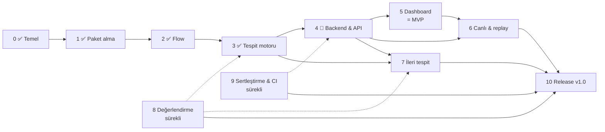

# NetGuard Yol Haritası

> Son güncelleme: **2026-10-22** · Mevcut sürüm: **v0.3.0** · Aktif faz: **Faz 4 — Backend, kalıcılık, API**
>
> Bu dosya projenin **tek** yol haritasıdır. Güncel iş listesi
> [docs/TASKS.md](docs/TASKS.md), ölçülmüş sonuçlar
> [docs/EVALUATION.md](docs/EVALUATION.md), mimari kararlar [docs/adr/](docs/adr/)
> altındadır.

Durum: ✅ tamamlandı · 🔄 devam ediyor · ⏳ başlanmadı · 👤 kullanıcı gerekli
(fiziksel lab, hesap ayarı veya yayın onayı).

---

## 1. Ürün vizyonu ve kapsam

**NetGuard**, ağ trafiğini (pcap/pcapng, kontrollü canlı yakalama) analiz eden,
paket/bağlantı/protokol özelliklerini çıkaran, şüpheli davranışı
**açıklanabilir kurallarla** tespit eden, her alarmı kanıtıyla birlikte
yapılandırılmış olarak üreten ve sonuçları bir web dashboard'da gösteren bir
ağ güvenliği izleme ve analiz platformudur.

**NetGuard'ı farklı kılan:**

1. **Açıklanabilirlik:** her alarm ne görüldüğünü, hangi eşiğin aşıldığını,
   saldırganın ne öğrendiğini ve ATT&CK karşılığını söyler. Kesinlik yerine
   kanıtın desteklediği ifade kullanılır ("possible ARP spoofing").
2. **Ölçülebilirlik:** tespit kalitesi etiketli senaryolar ve lab yakalamalarıyla
   ölçülür, sonuçlar (yanlış pozitifler dahil) yayınlanır.
3. **Saldırgan girdiye dayanıklılık:** her bayt düşmanca kabul edilir, tüm
   durum (state) sınırlıdır, sınır işlemleri O(1)'dir.
4. **Okunabilirlik:** küçük, test edilmiş, belgelenmiş bir kod tabanı.

**Kapsam dışı (bilinçli olarak):** satır hızında (10 Gbit/s) yakalama, inline
engelleme (IPS), imza tabanlı exploit tespiti, tam protokol ayrıştırma. Bunları
Zeek ve Suricata zaten iyi yapıyor; NetGuard onlarla özellik özellik yarışmaz,
ileride onların çıktılarını ek girdi olarak okuyabilir.

**Donanım hedefi:** MacBook Air M1 (geliştirme), Kali (UTM, saldırgan), ~4 GB
RAM'li Ubuntu sunucu (kurban / dağıtım hedefi). Bulut, ücretli API ve
mikroservis yok.

## 2. Mevcut durum (2026-10-22)

| Faz | Konu | Durum | Sürüm |
|---|---|---|---|
| 0 | Araştırma, mimari, temel | ✅ | v0.1.0 |
| 1 | Paket alma ve protokol analizi | ✅ | v0.1.0 + v0.2.0 |
| 2 | Flow ve özellik çıkarımı | ✅ | **v0.2.0** |
| 3 | Tespit motoru (genişletme) | ✅ | **v0.3.0** |
| 4 | Backend, kalıcılık, API | 🔄 | v0.4.0 |
| 5 | Web dashboard | ⏳ | v0.5.0 = **MVP** |
| 6 | Canlı yakalama ve replay | ⏳ | v0.6.0 |
| 7 | İleri tespit ve tehdit istihbaratı | ⏳ | v0.7.0 |
| 8 | Test, benchmark, değerlendirme | 🔄 sürekli · 👤 lab | v0.8.0 |
| 9 | Güvenlik sertleştirme ve CI/CD | 🔄 sürekli | v0.9.0 |
| 10 | Dokümantasyon, release, portföy | ⏳ | **v1.0.0** |

**Ölçülmüş durum (v0.3.0):** 11 tespit kuralı, 220 test, kapsama %95;
ruff, mypy `--strict` temiz; 242k paketlik referans pcap 11 kuralla ~2,45 sn /
36 MB (M1, ~97k paket/s); sahte kaynaklı 500k flow saldırısında tepe bellek
469 MB. Sentetik senaryolar: 13/13 saldırı senaryosu tespit edildi, 11 benign
senaryonun 8'i alarmsız (3 bilinen ve açıklanmış yanlış pozitif). Ayrıntı:
[EVALUATION.md](docs/EVALUATION.md).

**Gerçek dünyada doğrulama yok:** tüm tespit sonuçları şimdilik sentetik
senaryolardan. Lab yakalamaları (Faz 8) kullanıcının UTM ortamını gerektirir.

## 3. Fazlar arası bağımlılık

Faz 8 ve 9 her fazda sürekli yürütülür (her dedektör senaryo ve testle gelir,
her değişiklik CI'dan geçer); kendi fazlarında eksikler toplanıp tamamlanır.

**MVP (v0.5.0):** pcap yükle → analiz et → flow'ları, istatistikleri ve
kanıtlı alarmları dashboard'da incele → rapor/olay dışa aktar. Tüm tespitler
sentetik senaryolarda ölçülmüş, sınırlamalar belgelenmiş.

## 4. Çalışma yöntemi

Her faz için: gereksinim ve bağımlılık gözden geçirme → işlere bölme →
uygulama → test → hata düzeltme → doküman → commit/push → kabul kriterleri
karşılanınca faz kapanışı.

Her önemli algoritma ve güvenlik mekanizması için bir **öğrenme kontrol
noktası** vardır: problem, çözüm, neden bu çözüm, alternatifler, karmaşıklık,
sınırlamalar ve kısa deney/sorular. Bunlar `docs/learning/NN-*.md` (Türkçe)
notlarında toplanır.

Kurallar: her yeni dedektör bir saldırı senaryosu, bir **benign benzeri**
senaryo ve birim testlerle gelir; performans gerilemesi %20'yi geçemez;
ölçülmemiş sonuç yazılmaz; büyük kararlar ADR ile belgelenir.

---

## 5. Fazlar

### Faz 0 — Araştırma, mimari ve temel ✅

Kapsam analizi, Python + dpkt seçimi ([ADR-0001](docs/adr/0001-python-and-dpkt.md)),
canlı yakalamanın `tcpdump`'a devri ([ADR-0002](docs/adr/0002-capture-via-tcpdump.md)),
incident birleştirme ([ADR-0003](docs/adr/0003-incident-aggregation.md)), `uv`,
ruff, mypy `--strict`, pytest, CI (Linux/macOS × Python 3.11–3.13), MIT lisansı,
AI co-author trailer'larını reddeden `commit-msg` hook'u, SSH imzalı commit'ler.

### Faz 1 — Paket alma ve protokol analizi ✅

| # | İş | Durum |
|---|---|---|
| 1.1 | pcap/pcapng okuma, stdin dahil seek edilemeyen akışlar | ✅ v0.1 |
| 1.2 | Decoder: Ethernet, Linux SLL, BSD loopback, raw IP; IPv4/IPv6; TCP/UDP/ICMP/ICMPv6/ARP; DNS sorgu adı | ✅ v0.1 |
| 1.3 | Bozuk paketler sayılır, hata fırlatılmaz; fuzz testi | ✅ v0.1 |
| 1.4 | CLI: `analyze` (text/JSON/JSONL), `lab` | ✅ v0.1 |
| 1.5 | **Kendi pcap/pcapng okuyucuları:** çok arayüzlü pcapng (arayüz başına link tipi, `if_tsresol`), uzunluk alanı sınırları, kesik dosya raporlama ([ADR-0005](docs/adr/0005-own-capture-readers-and-fast-decoder.md)) | ✅ v0.2 |
| 1.6 | Decoder: TCP seq/ack, payload uzunluğu (IP uzunluğundan, snaplen'e dayanıklı), TTL, IP fragment işareti | ✅ v0.2 |
| 1.7 | `struct` tabanlı hızlı decode yolu + dpkt ile diferansiyel fuzz testi | ✅ v0.2 |
| 1.8 | Paket boyutu dağılımı, desteklenmeyen link tipi sayacı | ✅ v0.2 |

**Kabul kriterleri:** ✅ bozuk girdiyle çökmeme (fuzz), ✅ sınırlı bellek (düşmanca
uzunluk alanları testli), ✅ çok arayüzlü pcapng testli, ✅ CLI testli.

**Bilinen sınırlama:** IP fragment birleştirme yok (fragment'lar işaretlenir ve
sayılır); IPv6 extension header'lı paketlerde payload uzunluğu yakalanan
bayttan hesaplanır.

### Faz 2 — Flow ve özellik çıkarımı ✅ (v0.2.0)

| # | İş | Durum |
|---|---|---|
| 2.1 | Çift yönlü flow, originator tespiti (SYN-ACK ile yön düzeltme) | ✅ |
| 2.2 | Yön bazlı paket/bayt/payload sayaçları, süre, TCP bayrak birikimi, Zeek tarzı `history` | ✅ |
| 2.3 | Zeek uyumlu `conn_state` (S0, S1, SF, REJ, S2, S3, RSTO, RSTR, RSTOS0, RSTRH, SH, SHR, OTH) | ✅ |
| 2.4 | Retransmission ve sequence gap tespiti (RFC 1982 serial aritmetik) | ✅ |
| 2.5 | Zaman aşımı sınıfları ve O(1) expiry; port yeniden kullanımı; LRU eviction ([ADR-0004](docs/adr/0004-flow-semantics.md)) | ✅ |
| 2.6 | Dedektörlere `on_flow_end(flow)` kancası | ✅ |
| 2.7 | `netguard flows -f csv\|jsonl` | ✅ |
| 2.8 | İstatistikler: flow durum dağılımı, servisler, en büyük flow'lar, uyarlanabilir zaman serisi, sınırlı endpoint tablosu | ✅ |
| 2.9 | Alarm modeli v1: `rule_id`, deterministik `alert_id`, `schema_version`; sözleşme testi; [kural kataloğu](docs/rules/README.md) | ✅ |
| 2.10 | Tracker DoS düzeltmesi: dolu tabloda O(n) GC → O(1) LRU; anahtar başına bellek 1 996 → 668 bayt | ✅ |
| 2.11 | Gerçek lab yakalamasında `nmap -sS` durum dağılımı, Zeek `conn.log` karşılaştırması | 👤 Faz 8'e taşındı |

**Kabul kriterleri:** ✅ `flows` komutu çalışıyor, ✅ her TCP durumu el yapımı
paket dizisiyle test edildi, ✅ tüm alarmlarda `rule_id`/`schema_version`,
✅ performans gerilemesi yok (v0.1'den ~1,6× hızlı), ✅ sentetik sonuçlar v0.1
ile aynı (bilinçli incident düzeltmesi hariç). Lab doğrulaması 👤 Faz 8'de.

**Öğrenme notu:** [02 — Paketten bağlantıya](docs/learning/02-flows-and-tcp-state.md).

### Faz 3 — Tespit motoru ✅ (v0.3.0)

**Amaç:** istenen tespit kategorilerinin tamamını, her biri için gözlenebilir
davranış, mantık, eşik, kanıt, test ve FP/FN belgesiyle tamamlamak.

| # | İş | Kural | Durum |
|---|---|---|---|
| 3.1 | DNS ayrıştırıcı (`dns.py`): başlık, `rcode`, `qtype`, yanıtlar; sıkıştırma döngüsüne dayanıklı | — | ✅ |
| 3.2 | **TRW tarama dedektörü** (Jung vd., 2004), bağlantı olayları; pencere kuralı sonuca duyarlı (`max_open_ratio`) ([ADR-0006](docs/adr/0006-connection-events-and-outcome-aware-scans.md)) | NG-SCAN-002 | ✅ |
| 3.3 | UDP tarama (ICMP port unreachable, yanıt veren portlar) | NG-SCAN-003 | ✅ |
| 3.4 | Yavaş tarama | NG-SCAN-002 (TRW, 1 saatlik ufuk) | ✅ |
| 3.5 | **SYN flood:** hedef başına tamamlanmayan el sıkışmalar | NG-SYN-001 | ✅ |
| 3.6 | ICMP anomalileri | NG-SWEEP-001 (ICMP sweep) mevcut; ICMP tünel/payload kuralı Faz 7'ye ertelendi | 🔶 kısmi |
| 3.7 | DNS anomalileri: tünelleme, NXDOMAIN/DGA | NG-DNS-001, NG-DNS-002 | ✅ (onaysız resolver politikası Faz 7'ye) |
| 3.8 | Olağan dışı bağlantı sıklığı (host başına EWMA baseline, [ADR-0007](docs/adr/0007-per-host-baselines.md)) | NG-RATE-001 | ✅ |
| 3.9 | Olağan dışı trafik hacmi | NG-VOL-001 | ✅ |
| 3.10 | Parçalama ile atlatma (RFC 1858, `nmap -f`) | NG-FRAG-001 | ✅ |
| 3.11 | Her kural için saldırı + benign benzeri senaryo + kural sayfası | — | ✅ (24 senaryo, 11 sayfa) |
| 3.12 | `netguard rules`, kural bazında aç/kapa ve eşikler, ayarlanabilir `max_keys`, örnek config = varsayılanlar testi | — | ✅ |

**Kabul kriterleri:** ✅ brief'teki her kategori için en az bir kural; ✅ her
kural saldırı ve benign benzeri senaryoda test edildi; ✅ kural sayfaları
FP/FN ve ayar önerisi içeriyor; ✅ skor tablosu güncel; ✅ şüphe ifadesi kanıta
uygun ("possible …"); ✅ performans bütçesi (%20) içinde. Gerçek trafikte
doğrulama 👤 Faz 8'de.

**Öğrenme notları:** [03 — TRW ve ardışık hipotez testi](docs/learning/03-trw-and-sequential-testing.md),
[04 — DNS, baseline'lar ve parçalama](docs/learning/04-dns-baselines-fragments.md).

### Faz 4 — Backend, kalıcılık ve API ⏳ (v0.4.0)

| # | İş |
|---|---|
| 4.1 | Teknoloji kararı (ADR): aday SQLite (stdlib) + FastAPI; çekirdek bağımlılıksız kalır (`netguard[web]`) |
| 4.2 | Şema: `captures`, `analysis_jobs`, `flows`, `alerts`, `rules`, `stats`; sürümlü migrasyon |
| 4.3 | İş yaşam döngüsü: `queued → running → done/failed`, iptal, hata kaydı, kesilen işlerin kurtarılması |
| 4.4 | API v1: yükleme, analiz, flow/alarm arama, sıralama, filtreleme, sayfalama; OpenAPI dokümanı |
| 4.5 | Olay şeması: SIEM entegrasyonu için sürümlü JSON (ECS eşlemesi) |
| 4.6 | Entegrasyon testleri (`TestClient`), yükleme boyut/tür sınırları |

### Faz 5 — Web dashboard ⏳ (v0.5.0 = MVP)

| # | İş |
|---|---|
| 5.1 | Teknoloji kararı (ADR): sunucu tarafı render + htmx ile React/Vite SPA karşılaştırması |
| 5.2 | Güvenlik özeti, trafik istatistikleri, protokol dağılımı, flow ve endpoint görünümleri |
| 5.3 | Alarm akışı, alarm detayı ve kanıt görünümü, kural sayfalarına bağlantı |
| 5.4 | pcap yükleme ve analiz iş akışı; yükleme, boş ve hata durumları |
| 5.5 | Kural yönetimi; rapor (HTML/JSON) ve dışa aktarma |
| 5.6 | Pcap'ten gelen tüm stringler için XSS testi; yalnızca gerçek veri, sahte metrik yok |

### Faz 6 — Canlı yakalama ve replay ⏳ (v0.6.0)

| # | İş |
|---|---|
| 6.1 | `netguard monitor`: yetkili arayüzde `tcpdump` alt süreci, `-Z` ile yetki düşürme, başlat/durdur, kaynak sınırları |
| 6.2 | macOS/Linux izin farkları ve sınırlamaların belgelenmesi |
| 6.3 | Kaydedilmiş yakalamaların kontrollü replay'i ve farklı konfigürasyonla yeniden analiz |
| 6.4 | Alarm yaşam döngüsü: eşikte **erken uyarı**, incident sonunda nihai alarm, `max_incident_age` |
| 6.5 | Canlı = offline doğrulaması (`tcpreplay`, 👤 lab); 24 saatlik soak testi, paket kaybı ölçümü |

### Faz 7 — İleri tespit ve tehdit istihbaratı ⏳ (v0.7.0)

Her özellik ölçülebilir değerine göre seçilir. Adaylar: davranışsal baseline,
alarm tekilleştirme ve korelasyon (decoy tarama, DHCP korelasyonuyla ARP FP
azaltma), açıklanabilir güven/şiddet puanı, beaconing ve veri sızdırma,
Zeek `conn.log`/Suricata EVE JSON girdisi, kural içe/dışa aktarma, offline
IoC listeleri. ML yalnızca somut ve ölçülmüş bir kullanım durumu varsa.

### Faz 8 — Test, benchmark ve değerlendirme 🔄 sürekli · 👤 lab

| # | İş | Durum |
|---|---|---|
| 8.1 | Etiketli sentetik senaryolar, `lab evaluate`, CI'da skor tablosu | ✅ |
| 8.2 | Tekrarlanabilir benchmark'lar (`benchmarks/`), flood bellek testi | ✅ v0.2 |
| 8.3 | UTM lab: Kali → Ubuntu, izole host-only ağ ([LAB_SETUP.md](docs/LAB_SETUP.md)) | 👤 |
| 8.4 | Saldırı yakalamaları (`nmap` tipleri ve zamanlamaları, `masscan`, `arp-scan`, `bettercap`) ve ≥ 1 saat benign trafik | 👤 |
| 8.5 | Yakalama manifestosu (`eval/captures.toml`: sha256, araç, komut, beklenen alarm); `lab evaluate --manifest` | ⏳ |
| 8.6 | Precision/recall, benign trafikte saat başına alarm, tespit gecikmesi; açık veri setleri (lisansına uygun) | ⏳ |
| 8.7 | Kesilen iş, bozuk girdi, uzun çalışma senaryoları | ⏳ |

### Faz 9 — Güvenlik sertleştirme ve CI/CD 🔄 sürekli

Girdi doğrulama, yükleme/kaynak/zaman aşımı/depolama sınırları, API ve
dashboard erişim kontrolü (varsayılan `127.0.0.1`), gizli bilgi ve yakalama
verisinin sızmaması, bağımlılık lisans ve güvenlik taraması (`pip-audit`),
statik analiz (ruff `S` kuralları mevcut), GitHub Actions, kurulum/dağıtım
doğrulaması.

### Faz 10 — Dokümantasyon, release ve portföy ⏳ (v1.0.0)

Kod kalitesi incelemesi, mimari ve operasyon dokümanları, kurulum ve
geliştirici rehberi, gerçek demo ve ekran görüntüleri, desteklenen protokoller
ve tespit sınırlamaları, mühendislik değerlendirme raporu, CHANGELOG ve
release notları, GitHub release'i (👤 yayın onayı), LinkedIn portföy metni
taslağı.

**v1.0 tamamlanma tanımı:** brief'teki "Definition of Done" maddelerinin
hepsi kanıtla karşılanmış; karşılanamayan madde varsa açıkça yazılır ve tam
uyum iddia edilmez.

---

## 6. Teknoloji kararları

| Alan | Karar | Durum |
|---|---|---|
| Dil | Python 3.11+ (okunabilirlik, test edilebilirlik; performans ölçülerek yönetiliyor) | ADR-0001 |
| Paket ayrıştırma | Kendi pcap/pcapng okuyucuları + `struct` hızlı yol + dpkt yedek | ADR-0005 |
| Canlı yakalama | `tcpdump`/`dumpcap` alt süreci; NetGuard root çalışmaz | ADR-0002 |
| Alarm modeli | Incident birleştirme, `rule_id`, deterministik `alert_id`, şema 1.0 | ADR-0003 |
| Flow modeli | Zeek `conn_state` sözlüğü, zaman aşımı sınıfları, LRU | ADR-0004 |
| Sonuca duyarlı tespit | Bağlantı olayları, TRW + pencere kuralı, protokol bazlı dağıtım | ADR-0006 |
| Anomali baseline'ları | Host başına EWMA ortalama + mutlak sapma, kırpma | ADR-0007 |
| Depolama | SQLite (aday) | Faz 4 ADR |
| API | FastAPI (aday) | Faz 4 ADR |
| Dashboard | htmx vs React/Vite | Faz 5 ADR |

## 7. Test stratejisi

| Seviye | Ne | Araç | Ne zaman |
|---|---|---|---|
| Birim | Decoder, okuyucular, flow durumları, pencereler, dedektörler | pytest, el yapımı `Packet`/frame | Her commit (CI) |
| Diferansiyel | Hızlı decode yolu = dpkt yolu | 5 000 mutasyonlu frame | Her commit |
| Senaryo | Saldırı + benign benzeri; TP/FP/FN sabitlenmiş | `lab/scenarios.py` | Her commit |
| Dayanıklılık | Bozuk frame/dosya, düşmanca uzunluklar, flood bellek | `test_decode`, `test_formats`, `benchmarks/` | Her commit / release |
| Gerçek yakalama | Gerçek araç davranışı, benign FP oranı | Manifesto + yerel pcap'ler (git dışı) | Dedektör değişikliklerinde 👤 |
| Performans | Throughput, RSS; gerileme < %20 | `benchmarks/make_bench_pcap.py` | Her faz sonu |
| API/Web | Sözleşme, yükleme güvenliği, XSS | `TestClient` | Faz 4–5'ten itibaren |

Kapsama eşiği %90 (CI'da zorunlu). Gerçek pcap'ler git'e girmez (`.gitignore`).

## 8. Bilinen sorunlar

| Sorun | Etki | Hedef |
|---|---|---|
| Tek ARP bağlama değişikliği alarm üretiyor | `dhcp_reassignment` FP | Faz 7 (DHCP korelasyonu) |
| İzleme sunucusu ping sweep gibi görünüyor | `monitoring_poller` FP (allowlist ile çözülüyor) | Faz 7 (baseline) |
| Yanlış DNS arama son eki DGA gibi görünüyor | `search_suffix_nxdomain` FP (kanıt farkı gösteriyor) | Faz 7 |
| Aynı aktivite için birden çok kural | SYN taraması NG-SCAN-001 ve NG-SCAN-002 üretiyor | Faz 7 (korelasyon) |
| Baseline kuralları ısınma istiyor | 10 dakikadan kısa yakalamalarda hız/hacim alarmı yok | Faz 4 (kalıcı baseline) |
| Decoy/sahte kaynaklı taramalar | Bir tarama birçok kaynağa bölünüyor | Faz 7 |
| Idle-timeout gecikmesi | Canlı alarmlar ≥ 10 sn gecikiyor | 6.4 |
| IP fragment birleştirme yok | Parçalı probe'lar analiz edilmiyor; NG-FRAG-001 atlatmayı raporluyor | Faz 7 (gerekirse) |

## 9. Kullanıcı gerektiren işler 👤

- UTM lab kurulumu ve gerçek yakalamalar (8.3, 8.4); yalnızca sahip olunan,
  izole ağda.
- GitHub: repo görünürlüğünü değiştirmek (şu an private), release yayınlamak.
- Canlı yakalama testleri için yetkili arayüz seçimi ve `sudo`.

## 10. Bu dosyanın bakımı

- İş bitince durum burada, ayrıntı [docs/TASKS.md](docs/TASKS.md)'de güncellenir.
- Faz bitince §2 ve değişiklik kaydı güncellenir, CHANGELOG'a sürüm eklenir.
- Plan değişirse nedeni bir satırla aşağıya yazılır; mimari etkisi varsa ADR açılır.

### Değişiklik kaydı

- **2026-10-22:** Faz 3 tamamlandı (v0.3.0): 8 yeni kural (TRW, UDP tarama,
  SYN flood, DNS tünelleme, NXDOMAIN/DGA, parçalama, bağlantı sıklığı, hacim).
  ICMP tünel kuralı ve onaysız resolver politikası ölçülebilir değer
  gösterilene kadar Faz 7'ye ertelendi.
- **2026-10-22:** Yol haritası, proje brief'indeki 0–10 faz yapısına göre
  yeniden düzenlendi. Eski Faz 2 (lab) → Faz 8; eski Faz 3 (flow) → Faz 2;
  eski Faz 4–5 (tarama, SYN flood, DNS, hacim) → Faz 3; eski Faz 6–7 (rapor,
  API, dashboard) → Faz 4–5; eski Faz 8 (canlı) → Faz 6; eski Faz 9–10 →
  Faz 7. MVP, dashboard dahil olacak şekilde v0.5.0 olarak yeniden tanımlandı.
  Faz 2 tamamlandı (v0.2.0).
- **2026-10-21:** Yol haritası Türkçe olarak yeniden yazıldı, mevcut durum analizi eklendi.
- **2026-10-20:** Faz 0–1 tamamlandı (v0.1.0).
