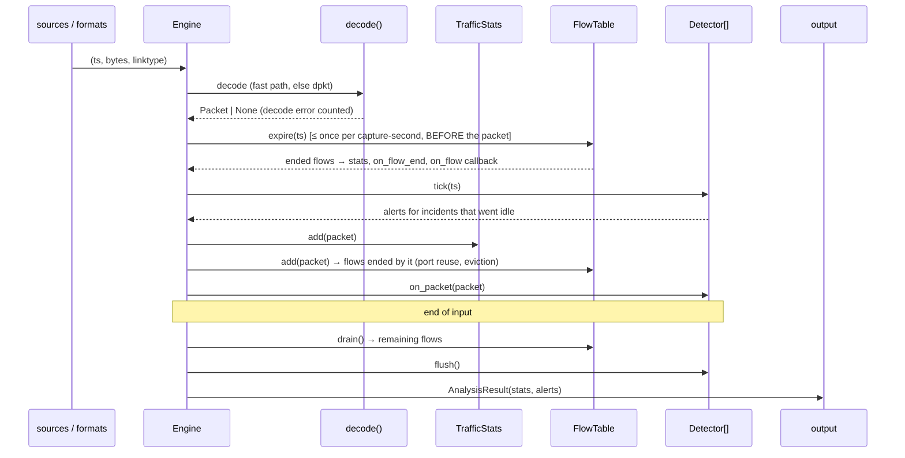

# Architecture

## Goals and non-goals

**Goals:** explainable detections, a low false-positive rate, reproducible
measurements, easy extension with new detectors, and enough speed for home and
lab networks or offline analysis on a 4 GB VM.

**Non-goals (for now):** line-rate capture on 10 Gbit links, inline blocking
(IPS), and full protocol dissection. Zeek and Suricata already do those well.
NetGuard aims to be small, readable and explainable, and can later consume
their logs as additional inputs.

## Pipeline



| Module | Responsibility | Key types |
|---|---|---|
| `formats.py` | Bounded pcap/pcapng readers: per-interface link types, length checks, truncation reporting (ADR-0005) | `iter_pcap`, `iter_pcapng`, `CaptureInfo` |
| `sources.py` | Pick the reader from the magic number. Files and non-seekable streams (stdin). | `iter_frames`, `open_capture` |
| `decode.py` | Turn link-layer bytes into a flat, immutable `Packet`. `struct` fast path plus dpkt fallback. Never raises on malformed input. | `decode`, `Packet` |
| `flows.py` | Bidirectional flows, Zeek-style connection state, retransmissions, timeout classes, bounded LRU table (ADR-0004) | `Flow`, `FlowTable` |
| `window.py` | Sliding-window distinct counting and incident aggregation. Shared by the scan detectors. | `SlidingDistinct`, `BurstTracker`, `Incident` |
| `detectors/` | One file per detection. Each one is a pure state machine with no I/O and no wall clock. | `Detector` ABC (`on_packet`, `on_flow_end`, `tick`, `flush`) |
| `engine.py` | Order of operations, capture-time ticking, alert and flow fan-out | `Engine`, `AnalysisResult` |
| `stats.py` | Bounded statistics: protocols, packet sizes, adaptive time series, flow states, services, top flows, endpoints | `TrafficStats` |
| `config.py` | Typed TOML config that rejects unknown keys, plus the allowlist | `Config`, `FlowConfig` |
| `output.py` | Text, JSON and JSONL alerts; CSV/JSONL flow export | `FlowWriter` |
| `lab/` | Frame builders, labelled scenarios, evaluation harness | `Scenario`, `run_all` |

## Design principles

1. **Detectors are pure.** A detector receives `Packet` (and finished `Flow`) objects and returns
   `Alert` objects. It does no I/O and never reads the wall clock. This makes
   every detector testable with a few hand-built packets (`tests/helpers.py`).
2. **Capture time, not wall-clock time.** A pcap analysed today and the same
   traffic analysed live produce the same alerts.
3. **Incidents, not events.** Threshold crossings open an *incident*. The
   incident keeps collecting evidence, including replies that arrive after the
   last probe, and becomes exactly one alert when it goes idle. This trades
   latency (`idle_timeout_seconds`, 10 s by default) for far better evidence
   and far less noise. See [ADR-0003](adr/0003-incident-aggregation.md).
4. **Bounded memory everywhere.** An attacker controls the input, so they also
   control how much state we create. Every map and window has a cap. When a
   cap is hit, we deliberately fail *open* (we may miss something), we count it
   (`evicted_keys`, `flows evicted`, `endpoints approximate`), and we never
   crash. Cap handling itself must be O(1): an O(n) rescan when full is a
   CPU-exhaustion attack (see learning note 02 §6).
5. **Explainability is a feature.** The text of `summary` is part of the
   contract and is covered by tests.

## Adding a detector

1. Create `src/netguard/detectors/<name>.py` with a subclass of `Detector`.
   Implement `on_packet` and/or `on_flow_end`, and also `tick`/`flush` if it
   aggregates. Give each alert a new stable `rule_id` (`NG-<AREA>-<NNN>`) and
   write its page in `docs/rules/`.
2. Add a config dataclass in `config.py` and register it in `_SECTIONS`.
3. Register the detector in `detectors/__init__.py::build_detectors`.
4. Add unit tests built from `Packet` objects, plus at least one attack
   scenario and one *benign look-alike* scenario in `lab/scenarios.py`.
5. Update `tests/test_scenarios.py`, regenerate the table in
   `docs/EVALUATION.md`, and add the detector to the README.

## Data model

`Alert` is the stable external contract (JSON keys, `schema_version` 1.0).
Adding a field bumps the minor version; renaming or removing one bumps the
major. `tests/test_cli.py::test_alert_contract_v1` pins the key set.

```json
{
  "schema_version": "1.0",
  "alert_id": "4b41e3294d7a7b7e3717",
  "rule_id": "NG-SCAN-001",
  "detector": "portscan",
  "title": "TCP port scan",
  "severity": "HIGH",
  "first_seen": "2025-10-09T08:53:20.000+00:00",
  "last_seen": "2025-10-09T08:53:20.999+00:00",
  "src": "10.0.0.66",
  "dst": "10.0.0.10",
  "summary": "10.0.0.66 probed 1000 distinct TCP ports on 10.0.0.10 in 1.0s (...)",
  "technique": {"id": "T1046", "name": "Network Service Discovery", "url": "https://attack.mitre.org/techniques/T1046/"},
  "evidence": {"distinct_ports": 1000, "open_ports": [22, 80, 443], "...": "..."}
}
```

`alert_id` is deterministic (hash of `rule_id`, `src`, `dst`, `first_seen`):
re-analysing a capture yields the same ids, so downstream systems can
de-duplicate. Rules are documented in the [rule catalog](rules/README.md).

Flow records (`netguard flows`) have the fields of `Flow.to_dict()`: the
5-tuple oriented originator → responder, timestamps, `state` (Zeek
`conn_state`), `history`, per-direction packets/bytes/payload bytes,
`retransmissions`, `seq_gaps` and `end_reason`.

A future version may map these fields to the Elastic Common Schema (ECS) for
direct SIEM ingestion. See the [roadmap](../ROADMAP.md).
