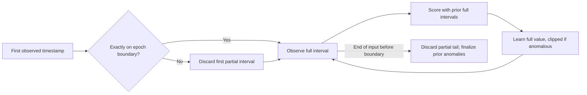

# Baseline observation boundaries (1.0.0rc2)

The strongest objection to discarding partial intervals is missed activity at capture edges.
We accept that loss to avoid learning an incomplete count as a full-minute workload.
Extrapolation assumes a constant arrival rate and amplifies a short burst.
Capture-relative windows would shift every boundary and change the existing rule contract.

Intervals remain epoch-aligned and half-open: `[k * interval, (k+1) * interval)`.
A boundary packet belongs to the next interval and completes the previous observation.
A first timestamp exactly on a boundary starts a complete interval.
Any other first timestamp causes that first interval to be discarded.
Silent complete intervals count as zero for already tracked hosts.
Warm-up counts only learned complete intervals, not discarded edges.

At EOF, no future time is invented. The unfinished tail neither trains nor scores.
An anomaly from completed intervals still produces its final alert.
The tail cannot increase its total, peak, duration or last-seen time.
Live `advance()` may complete a silent interval using real elapsed capture time.
An offline file ends at its last observed packet; it cannot prove subsequent silence.
This can explain a live/offline difference at the tail; it must be reported.

Before the fix, one connection at `59.9s` trained a mean of one at `60s`.
With one warm-up interval, 100 connections at `60.1s` produced an EOF alarm ending at `120s`.
Only `0.2s` of observation existed, and that end time was never observed.
After the fix, neither partial interval trains or scores.

Regression tests cover exact boundaries, six partial start offsets, silent gaps,
clipped learning, warm-up, repeated drain and both rate/volume detectors.
Thresholds and fixed-window alignment are unchanged.
A burst split across two complete windows can still miss the threshold.
A burst wholly inside the discarded tail can also be missed.
Neither limitation is resolved by this change.
