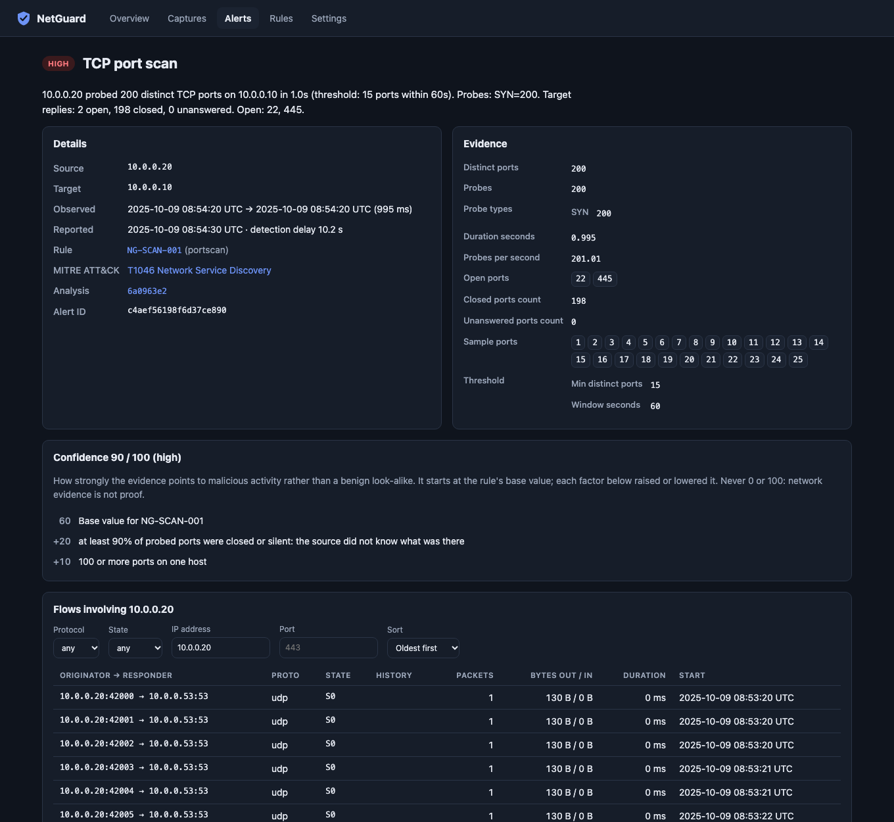
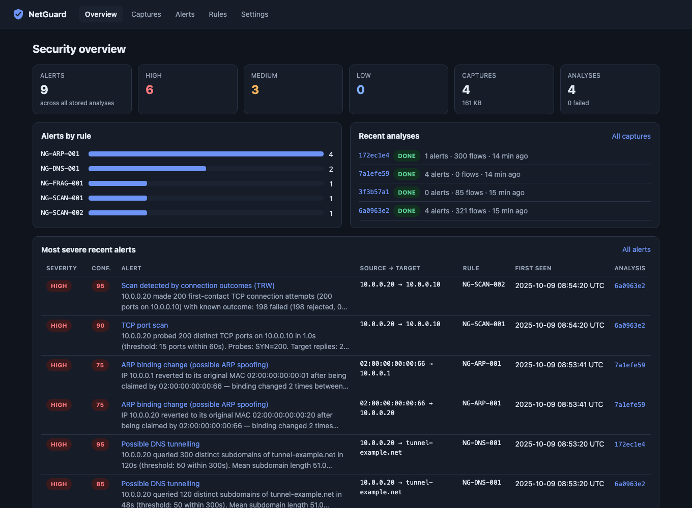
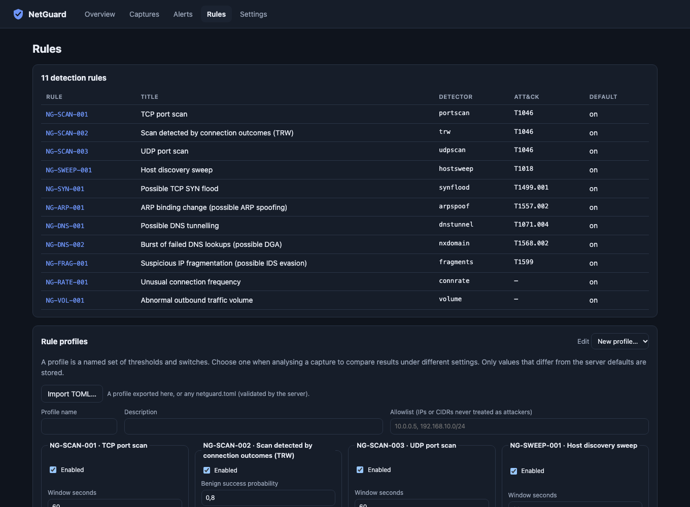

# Demo

Everything on this page comes from real NetGuard runs on the **synthetic lab
scenarios** shipped with NetGuard (`netguard lab generate`), not from real
networks and not from mock data. The traffic is generated, labelled and
reproducible; the analyses, alerts and screenshots are what NetGuard actually
produced. Real-network results are a separate step (see [LAB_SETUP.md](LAB_SETUP.md)).

## Reproduce

```bash
uv sync && pnpm --dir frontend install && pnpm --dir frontend build
uv run netguard lab generate lab-pcaps/
uv run netguard analyze lab-pcaps/compromised_workstation.pcap
uv run netguard serve --data-dir ./demo-data          # then upload the pcaps in "Captures"
```

The screenshots below used the scenarios `compromised_workstation`,
`benign_office`, `arp_spoof_mitm` and `dns_tunnel`, uploaded through the
API with server defaults (NetGuard 0.8.0 plus the Phase 10 changes, Chrome
headless at 1360 px, dark theme, which the dashboard follows from the system setting).

## Command line

`compromised_workstation` is one host (10.0.0.20) that tunnels data over DNS,
then scans a server and sends fragmented probes. NetGuard raises four alerts
from four rules and correlates them into one incident (first part of the
output; the full text explains every alert):

```text
NetGuard 0.8.0 — compromised_workstation.pcap

Packets: 582   Bytes: 39,748   Duration: 70.2s   Flows: 321   Decode errors: 0
Protocols: tcp 402, udp 120, ip-frag 40, ip-other 20
Flow states: REJ 198, S0 121, RSTO 2
Top services (flows): udp/53 120, tcp/21 1, tcp/22 1, tcp/23 1, tcp/25 1
Top talkers: 10.0.0.20 (38,148 B), 10.0.0.10 (22,548 B), 10.0.0.53 (15,600 B)

Alerts: 4 (3 HIGH, 1 MEDIUM)
Incidents: 1 (alerts grouped by actor and time)
  - [HIGH, confidence 95] 10.0.0.20: 4 alerts from 4 rules across 3 ATT&CK tactics (Defense Evasion → Discovery → Command and Control) — Possible DNS tunnelling, Scan detected by connection outcomes (TRW), Suspicious IP fragmentation (possible IDS evasion), TCP port scan.

[HIGH] Possible DNS tunnelling: 10.0.0.20 -> tunnel-example.net  T1071.004 Application Layer Protocol: DNS  confidence 85 (high)
```

## Dashboard

**Analysis:** the incident with its ATT&CK tactics, the alerts with confidence,
traffic statistics. The traffic chart shows the DNS lookups as a low baseline,
the 200-port scan as one spike at 08:54:20 and the fragments at 08:54:30.


**Alert detail:** the evidence behind NG-SCAN-001, how the confidence score was
built from the rule's base value, and the flows of the source host.



**Overview:** alerts across all stored analyses. The benign office scenario
(`3f3b57a1`) raised no alerts.



**Rules:** the 11 rules with their ATT&CK techniques, and the profile editor
for re-analysing with different thresholds.


