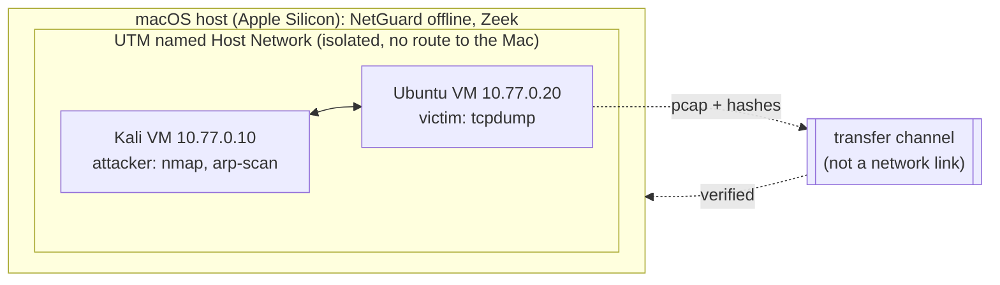

# Lab setup: validating NetGuard on real traffic

This guide describes the **isolated** lab used to measure NetGuard on real
traffic, and the scripts in [`eval/lab/`](../eval/lab/) that run the
experiments with as few manual steps as possible. No result from this lab
exists yet; [EVALUATION.md § 6](EVALUATION.md#6-real-captures) says so until
it does.



> ⚠️ **Rules of engagement.** Scans, floods and ARP spoofing run **only**
> between the two lab VMs on 10.77.0.0/24. Never against the home network,
> the physical Ubuntu server, the university (ITU) or an ISP network.
> Scanning networks you do not own can be illegal, including under Turkish
> Penal Code art. 243–244, and violates acceptable-use policies. The lab
> scripts refuse to run outside 10.77.0.0/24.

## 1. Network (as built, UTM 5.0.8)

- Both VMs are attached to the **same named Host Network** (one network UUID
  shared by both VMs). Selecting "Host Only" on each VM separately does not by
  itself put them on one network; the shared network identity does. Check
  it on the running VMs, not only in the settings.
- In this lab, `isolated=on` on the Ubuntu VM blocked VM-to-VM traffic; it is
  off. Check after every change: `ping -c 3 10.77.0.20` from Kali.
- The Mac is **not** reachable from this network, and the VMs have no routed
  internet. Nothing in this guide assumes otherwise: no `scp`, no `apt`, no
  `pip` inside the VMs during experiments. "Isolated" does not mean silent,
  though: exp01's capture contained SSDP multicast from the UTM host side of
  the shared network, so a capture may hold host-originated traffic besides
  the experiment. Do not document the lab as traffic-free.
- Do not add a second NIC, SSH keys or routes for convenience. Any change to
  the lab network is coordinated separately and recorded with the results.

## 2. What runs where

| Machine | Role | Never |
|---|---|---|
| Kali VM (10.77.0.10) | Generates attack traffic with the scripts in `eval/lab/` | Targets anything but 10.77.0.20 |
| Ubuntu VM (10.77.0.20) | Victim; captures with `tcpdump` | Captures on any interface but the lab one |
| Mac | Builds NetGuard, verifies and analyses the transferred captures, runs Zeek on them | Joins the lab network |
| Physical Ubuntu server (`bistlab`) | Not part of the attack lab | Target, capture point or test host for attacks; its services are left untouched |

## 3. Moving files: requirements for the transfer channel

The lab has no network path to the Mac, so files move through a channel the
lab owner sets up (for example a UTM shared directory or a disk image
attached for the transfer). Whatever it is, it must satisfy:

1. **No network bridge.** It must not give the VMs a route to the Mac, the
   home network or the internet.
2. **Direction and content.** Mac → VMs: the scripts in `eval/lab/` (and,
   for the live test later, a NetGuard wheelhouse). VMs → Mac: only the files
   the scripts write (`NAME.pcap`, `NAME.sha256`, `NAME.meta.txt` from
   Ubuntu; `NAME.attack.txt`, `NAME.nmap.txt` from Kali).
3. **Integrity.** The victim hashes each capture right after tcpdump stops;
   `ingest.py` on the Mac refuses a capture whose hash differs. Check the
   scripts after copying them into a VM: `sha256sum *.sh` there must match
   `shasum -a 256 eval/lab/*.sh` on the Mac.
4. **Confidentiality.** Captures stay in git-ignored `captures/`; nothing is
   committed before review.

If no such channel can be set up, the small `.attack.txt`/`.meta.txt` files
can be typed over, but a pcap cannot: the experiment then waits.

## 4. Check the Ubuntu VM (one command)

On the Ubuntu VM, before anything else. It only reads; it changes nothing:

```bash
. /etc/os-release; echo "$PRETTY_NAME $(uname -m)"; for t in python3 tcpdump sha256sum ip timeout sudo; do printf '%-10s %s\n' "$t" "$(command -v $t || echo MISSING)"; done; python3 -V; tcpdump --version 2>&1 | head -1; ip -br -4 addr
```

Needed for the capture experiments: `tcpdump`, `sha256sum`, `ip`, `timeout`,
`sudo`, and an interface with `10.77.0.20`. Python 3 (≥ 3.11) is needed only
later, to run NetGuard itself on the VM for the live test. Send the output
back before the first experiment; the plan adapts to what is missing.

## 5. Experiment 01: SYN scan (the first one to run)

Ground truth, written before the run: [`eval/lab/experiments.toml`](../eval/lab/experiments.toml)
expects NG-SCAN-001 (`portscan`, `10.77.0.10->10.77.0.20`) and NG-SCAN-002
(`trw`, `10.77.0.10`).

1. **Ubuntu:** `bash victim-capture.sh exp01-syn-scan`
   It finds the 10.77.0.x interface (refuses if there is none), asks for the
   sudo password first, starts tcpdump, and prints `>>> Capture is running`
   only after tcpdump itself has reported `listening on`. If sudo is refused,
   tcpdump is missing, the interface is down or tcpdump does not report
   `listening on` within 10 s, it says `do NOT start the experiment` (or
   `FAILED`), keeps no pcap and exits with status 1. **Start Kali only after
   the `>>> Capture is running` line.**
2. **Kali:** `bash kali-exp01-syn-scan.sh`
   It checks that it runs on 10.77.0.10 and reaches 10.77.0.20 on the lab
   network, asks you to type `capture-running`, then runs
   `sudo nmap -sS -Pn -n -p 1-1000 --max-retries 1 10.77.0.20` and records the
   nmap version, the command and UTC times.
3. **Ubuntu:** wait about 15 s after nmap has finished, then `Ctrl-C`. The
   script records tcpdump's packet and kernel-drop counts and the SHA-256.
4. **Transfer** the files listed in § 3 into one directory on the Mac.
5. **Mac:**

   ```bash
   python3 eval/lab/ingest.py /path/to/transfer-dir
   mkdir -p eval/reports
   uv run netguard lab evaluate --manifest eval/captures.toml --format json > eval/reports/exp01.json
   uv run netguard lab evaluate --manifest eval/captures.toml
   ```

Before the real run, the scripts were exercised in a disposable Ubuntu
26.04 container on the Mac, with two network namespaces on a veth pair
standing in for the VMs (nmap 7.98, tcpdump 4.99.6), as a normal user with
sudo rights. The guards refused a non-lab address and a missing
confirmation; the capture refused cleanly when sudo was refused, tcpdump was
missing, the interface was down or tcpdump never reported `listening on`;
the ready line always came after tcpdump's `listening on`; a Ctrl-C sent to
the whole foreground process group (as a terminal does) kept tcpdump's
packet and drop counts; and `ingest.py` rejected a modified capture. That
testing found that without `--immediate-mode` a Ctrl-C soon after the last
packet lost 11 of 11 packets while tcpdump reported 0 kernel drops; the
script now uses it, and `ingest.py` warns when tcpdump wrote fewer packets
than it received. These runs tested the scripts, not NetGuard on real
traffic, and are not lab results.

## 6. Later experiments

Each gets a script and its ground truth in `experiments.toml` before it runs.

| Experiment | Command (Kali → 10.77.0.20 only) | Expected rules (current defaults) |
|---|---|---|
| Connect scan | `nmap -sT -Pn -p 1-1000 10.77.0.20` | NG-SCAN-001, NG-SCAN-002 |
| XMAS / NULL / FIN | `sudo nmap -sX -Pn -p 1-1000 10.77.0.20` (`-sN`, `-sF`) | NG-SCAN-001 only: TRW needs SYN-based probes |
| Slow scan | `sudo nmap -sS -Pn -T1 -p 1-50 10.77.0.20` (about 15 s per probe) | NG-SCAN-002 (TRW has no time window); NG-SCAN-001 is expected to miss it (at most ~4 ports per 60 s, threshold 15) |
| UDP scan | `sudo nmap -sU -Pn --top-ports 100 10.77.0.20` | NG-SCAN-003 (`udpscan`); evidence depends on the victim's ICMP rate limit |
| ARP / ping sweep | `sudo nmap -sn 10.77.0.0/24` | NG-SWEEP-001 (`hostsweep`, ≥ 15 hosts in 60 s) |
| Fragmented scan | `sudo nmap -sS -f -Pn -p 1-100 10.77.0.20` | NG-FRAG-001; the probes inside the fragments are not analysed (no reassembly) |
| ARP spoofing | Needs a third address on the lab network to impersonate; designed when the network allows it | NG-ARP-001 |
| Benign baseline | Done as benign-01 (live, `victim-live-rss.sh benign-01 3640` + `kali-benign.sh 3600`): 0 alerts; see [EVALUATION.md § 6](EVALUATION.md) | no alerts is the goal; every alert is reported |

SYN floods (`hping3 --flood`) wait until the capture and drop counts of the
simpler experiments are understood; `exp10-syn-burst` is a bounded burst
instead.

### Run order for the remaining experiments

Done: exp01 (offline), live-syn-01, benign-01. The remaining ones, most
informative first. Each run is two terminals: **Ubuntu first**, Kali only
after Ubuntu prints `>>> Capture is running`. Then stop Ubuntu with `Ctrl-C`
about 15 s after Kali finishes (or let the duration end), and transfer
`~/ng-captures/NAME.*` (Ubuntu) and `~/ng-experiments/NAME.*` (Kali).

| # | Experiment | Why now | Expected (ground truth in `experiments.toml`) |
|---|---|---|---|
| 1 | `exp02-connect-scan` | Full handshakes: many short SF/REJ flows for the Zeek comparison | NG-SCAN-001, NG-SCAN-002 |
| 2 | `exp07-udp-scan` | First UDP request/reply traffic compared with Zeek (checklist item 2) | NG-SCAN-003 |
| 3 | `exp03-xmas-scan`, `exp04-fin-scan`, `exp05-null-scan` | Non-SYN scans: TRW must stay silent | NG-SCAN-001 only |
| 4 | `exp08-ping-sweep` | Host discovery | NG-SWEEP-001 |
| 5 | `exp09-frag-scan` | Fragment evasion | NG-FRAG-001 |
| 6 | `exp06-slow-scan` | About 12 min; the window rule is expected to miss it | NG-SCAN-002 only |
| 7 | `exp10-syn-burst` | Last: 1500 SYNs at ~100/s, needs `hping3` | NG-SYN-001 |
| 8 | `live-syn-02` (live, early warnings on) | Live delay with early warnings (task 8.11c) | as exp01 |

`kali-run.sh` must be in the transfer share first (the share holds only the
exp01 wrapper). Ubuntu, for experiments 1-7 (replace NAME):

```bash
bash /mnt/ng-transfer/scripts/victim-capture.sh NAME          # Ctrl-C ~15 s after Kali finishes
```

Kali:

```bash
bash /mnt/ng-transfer/kali-run.sh NAME                        # type capture-running when asked
```

For 8, the live runner on Ubuntu (`NETGUARD` set as in § 7) and the SYN scan
on Kali. `kali-run.sh` names its record after the experiment, so keep the
exp01 record first:

```bash
bash /mnt/ng-transfer/victim-live-rss.sh live-syn-02 120     # Ubuntu
mv ~/ng-experiments/exp01-syn-scan.attack.txt ~/ng-experiments/exp01-syn-scan.first.attack.txt   # Kali, once
bash /mnt/ng-transfer/kali-run.sh exp01-syn-scan              # Kali
```

## 7. Live capture on the victim (after the offline experiments)

The VMs have no internet, so NetGuard is brought over the transfer channel as
a single-file app (`netguard-lab.pyz`, built from this branch, bundling the
pure-Python `dpkt`; Python ≥ 3.11 on the VM). A VirtFS share may be
unreadable by the normal user (host 0700 / UID mismatch), so copy the file
into a local path the user owns and run it with the system python:

```bash
sudo install -m 0644 /mnt/ng-transfer/netguard-lab.pyz ~/ng-captures/netguard-lab.pyz
export NETGUARD="python3 $HOME/ng-captures/netguard-lab.pyz"
$NETGUARD --version
```

Then run the live capture with the helper, which keeps NetGuard a normal user
and starts tcpdump via `sudo -n` (`sudo -v` caches the credential once; no
persistent `setcap` needed):

```bash
bash victim-live-rss.sh benign-01 3600          # uses $NETGUARD; see § 8
```

It announces readiness only after a tcpdump capture process is actually
running, records the monitor's exit status, kernel-drop count, RSS samples and
measured elapsed time, and reports NEEDS REVIEW instead of success on a failed,
empty or under-sampled run. Then compare the live final alerts with offline
analysis of the written file with `eval/lab/live_offline_equal.py` (acceptance
criterion "Live = offline" below).

## 8. Recording results: manifest, Zeek, acceptance criteria

`ingest.py` writes `eval/captures.toml` (git-ignored) from the labels in
`experiments.toml` and the hashes, tool versions and commands recorded during
the runs. Never edit labels after seeing results; a miss is a result.

```bash
uv run netguard lab evaluate --manifest eval/captures.toml --format json > eval/reports/lab.json
zeek -r captures/exp01-syn-scan.pcap LogAscii::use_json=T     # in an empty directory, same file
uv run netguard lab compare-flows captures/exp01-syn-scan.pcap conn.log > eval/reports/exp01.zeek.json
```

Details and the meaning of every number: [CAPTURE_EVALUATION.md](CAPTURE_EVALUATION.md).

### Acceptance criteria (fixed before any lab result exists)

| Check | Pass when | Recorded as |
|---|---|---|
| Attack detection | Every planned attack experiment detected by ≥ 1 expected rule; entity-level recall ≥ 0.8 over all lab attacks | TP/FN per experiment, recall |
| Benign noise | ≥ 1 h of benign traffic with the default configuration: ≤ 1 final alert per hour; every alert explained | FP/hour, the alerts |
| Live = offline | `monitor --write` final alerts equal `analyze` of the written file, when tcpdump reports 0 kernel drops | diff of the two JSON outputs, drop counts |
| Flow states | `compare-flows` equal, or every mismatch explained in writing (timeouts, offload artefacts) | comparison JSON |
| Resources | 1 h live session: RSS stays below 500 MB, no state-loss warnings on benign traffic | `ps` samples, the summary line |
| Confidence | Each confidence factor separates true from false alerts on lab data, else it is removed | per-factor table |

A failed criterion is a result, not something to tune away silently: record
it in `EVALUATION.md § Real captures` with the fix or the limitation.

Do **not** commit captures, manifests with private addresses, or reports
until they have been reviewed.
