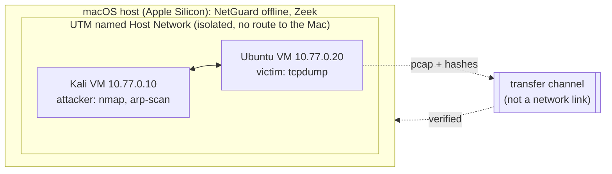

# Lab setup: validating NetGuard on real traffic

This guide describes the **isolated** lab used to measure NetGuard on real
traffic, and the scripts in [`eval/lab/`](../eval/lab/) that run the
experiments with as few manual steps as possible. No result from this lab
exists yet; [EVALUATION.md § 6](EVALUATION.md#6-real-captures) says so until
it does.



> ⚠️ **Rules of engagement.** Scans, floods and ARP spoofing run **only**
> between the two lab VMs on 10.77.0.0/24. Never against the home network,
> the physical Ubuntu server, the university (ITU) or an ISP network.
> Scanning networks you do not own can be illegal, including under Turkish
> Penal Code art. 243–244, and violates acceptable-use policies. The lab
> scripts refuse to run outside 10.77.0.0/24.

## 1. Network (as built, UTM 5.0.8)

- Both VMs are attached to the **same named Host Network** (one network UUID
  shared by both VMs). Selecting "Host Only" on each VM separately does not by
  itself put them on one network; the shared network identity does. Check
  it on the running VMs, not only in the settings.
- In this lab, `isolated=on` on the Ubuntu VM blocked VM-to-VM traffic; it is
  off. Check after every change: `ping -c 3 10.77.0.20` from Kali.
- The Mac is **not** reachable from this network, and the VMs have no
  internet. Nothing in this guide assumes otherwise: no `scp`, no `apt`, no
  `pip` inside the VMs during experiments.
- Do not add a second NIC, SSH keys or routes for convenience. Any change to
  the lab network is coordinated separately and recorded with the results.

## 2. What runs where

| Machine | Role | Never |
|---|---|---|
| Kali VM (10.77.0.10) | Generates attack traffic with the scripts in `eval/lab/` | Targets anything but 10.77.0.20 |
| Ubuntu VM (10.77.0.20) | Victim; captures with `tcpdump` | Captures on any interface but the lab one |
| Mac | Builds NetGuard, verifies and analyses the transferred captures, runs Zeek on them | Joins the lab network |
| Physical Ubuntu server (`bistlab`) | Not part of the attack lab | Target, capture point or test host for attacks; its services are left untouched |

## 3. Moving files: requirements for the transfer channel

The lab has no network path to the Mac, so files move through a channel the
lab owner sets up (for example a UTM shared directory or a disk image
attached for the transfer). Whatever it is, it must satisfy:

1. **No network bridge.** It must not give the VMs a route to the Mac, the
   home network or the internet.
2. **Direction and content.** Mac → VMs: the scripts in `eval/lab/` (and,
   for the live test later, a NetGuard wheelhouse). VMs → Mac: only the files
   the scripts write (`NAME.pcap`, `NAME.sha256`, `NAME.meta.txt` from
   Ubuntu; `NAME.attack.txt`, `NAME.nmap.txt` from Kali).
3. **Integrity.** The victim hashes each capture right after tcpdump stops;
   `ingest.py` on the Mac refuses a capture whose hash differs. Check the
   scripts after copying them into a VM: `sha256sum *.sh` there must match
   `shasum -a 256 eval/lab/*.sh` on the Mac.
4. **Confidentiality.** Captures stay in git-ignored `captures/`; nothing is
   committed before review.

If no such channel can be set up, the small `.attack.txt`/`.meta.txt` files
can be typed over, but a pcap cannot: the experiment then waits.

## 4. Check the Ubuntu VM (one command)

On the Ubuntu VM, before anything else. It only reads; it changes nothing:

```bash
. /etc/os-release; echo "$PRETTY_NAME $(uname -m)"; for t in python3 tcpdump sha256sum ip timeout sudo; do printf '%-10s %s\n' "$t" "$(command -v $t || echo MISSING)"; done; python3 -V; tcpdump --version 2>&1 | head -1; ip -br -4 addr
```

Needed for the capture experiments: `tcpdump`, `sha256sum`, `ip`, `timeout`,
`sudo`, and an interface with `10.77.0.20`. Python 3 (≥ 3.11) is needed only
later, to run NetGuard itself on the VM for the live test. Send the output
back before the first experiment; the plan adapts to what is missing.

## 5. Experiment 01: SYN scan (the first one to run)

Ground truth, written before the run: [`eval/lab/experiments.toml`](../eval/lab/experiments.toml)
expects NG-SCAN-001 (`portscan`, `10.77.0.10->10.77.0.20`) and NG-SCAN-002
(`trw`, `10.77.0.10`).

1. **Ubuntu:** `bash victim-capture.sh exp01-syn-scan`
   It finds the 10.77.0.x interface (refuses if there is none), starts
   tcpdump and prints `Capture is running`.
2. **Kali:** `bash kali-exp01-syn-scan.sh`
   It checks that it runs on 10.77.0.10 and reaches 10.77.0.20 on the lab
   network, asks you to type `capture-running`, then runs
   `sudo nmap -sS -Pn -n -p 1-1000 --max-retries 1 10.77.0.20` and records the
   nmap version, the command and UTC times.
3. **Ubuntu:** wait about 15 s after nmap has finished, then `Ctrl-C`. The
   script records tcpdump's packet and kernel-drop counts and the SHA-256.
4. **Transfer** the files listed in § 3 into one directory on the Mac.
5. **Mac:**

   ```bash
   python3 eval/lab/ingest.py /path/to/transfer-dir
   mkdir -p eval/reports
   uv run netguard lab evaluate --manifest eval/captures.toml --format json > eval/reports/exp01.json
   uv run netguard lab evaluate --manifest eval/captures.toml
   ```

Before the real run, the scripts were exercised in a disposable Ubuntu
26.04 container on the Mac, with two network namespaces on a veth pair
standing in for the VMs (nmap 7.98, tcpdump 4.99.6). The guards refused a
non-lab address and a missing confirmation, the capture and hashing worked,
and `ingest.py` rejected a modified capture. That run tested the scripts,
not NetGuard on real traffic, and is not a lab result.

## 6. Later experiments

Each gets a script and its ground truth in `experiments.toml` before it runs.

| Experiment | Command (Kali → 10.77.0.20 only) | Expected rules (current defaults) |
|---|---|---|
| Connect scan | `nmap -sT -Pn -p 1-1000 10.77.0.20` | NG-SCAN-001, NG-SCAN-002 |
| XMAS / NULL / FIN | `sudo nmap -sX -Pn -p 1-1000 10.77.0.20` (`-sN`, `-sF`) | NG-SCAN-001 only: TRW needs SYN-based probes |
| Slow scan | `sudo nmap -sS -Pn -T1 -p 1-50 10.77.0.20` (about 15 s per probe) | NG-SCAN-002 (TRW has no time window); NG-SCAN-001 is expected to miss it (at most ~4 ports per 60 s, threshold 15) |
| UDP scan | `sudo nmap -sU -Pn --top-ports 100 10.77.0.20` | NG-SCAN-003 (`udpscan`); evidence depends on the victim's ICMP rate limit |
| ARP / ping sweep | `sudo nmap -sn 10.77.0.0/24` | NG-SWEEP-001 (`hostsweep`, ≥ 15 hosts in 60 s) |
| Fragmented scan | `sudo nmap -sS -f -Pn -p 1-100 10.77.0.20` | NG-FRAG-001; the probes inside the fragments are not analysed (no reassembly) |
| ARP spoofing | Needs a third address on the lab network to impersonate; designed when the network allows it | NG-ARP-001 |
| Benign baseline | ≥ 1 h of ordinary use of the victim, no scanning: `bash victim-capture.sh benign-01 3600` | no alerts is the goal; every alert is reported |

SYN floods (`hping3 --flood`) wait until the capture and drop counts of the
simpler experiments are understood.

## 7. Live capture on the victim (after the offline experiments)

The VMs have no internet, so NetGuard is installed from a wheelhouse brought
over the transfer channel. The analyser needs only `dpkt` (pure Python), so
for `netguard monitor` two wheels suffice (Python ≥ 3.11 on the VM):

```bash
# on the Mac
uv build --wheel -o wheelhouse && python3 -m pip download dpkt==1.9.8 --no-deps -d wheelhouse
# on the Ubuntu VM, after the transfer
python3 -m venv ~/ng && ~/ng/bin/pip install --no-index --find-links wheelhouse netguard
sudo setcap cap_net_raw,cap_net_admin=eip "$(command -v tcpdump)"   # once, see LIVE_CAPTURE.md
~/ng/bin/netguard monitor -i <lab-interface> --write ~/ng-captures/live-01.pcap -f jsonl > ~/ng-captures/live-01.jsonl
```

Then compare the live final alerts with `netguard analyze` of the written
file (acceptance criterion "Live = offline" below).

## 8. Recording results: manifest, Zeek, acceptance criteria

`ingest.py` writes `eval/captures.toml` (git-ignored) from the labels in
`experiments.toml` and the hashes, tool versions and commands recorded during
the runs. Never edit labels after seeing results; a miss is a result.

```bash
uv run netguard lab evaluate --manifest eval/captures.toml --format json > eval/reports/lab.json
zeek -r captures/exp01-syn-scan.pcap LogAscii::use_json=T     # in an empty directory, same file
uv run netguard lab compare-flows captures/exp01-syn-scan.pcap conn.log > eval/reports/exp01.zeek.json
```

Details and the meaning of every number: [CAPTURE_EVALUATION.md](CAPTURE_EVALUATION.md).

### Acceptance criteria (fixed before any lab result exists)

| Check | Pass when | Recorded as |
|---|---|---|
| Attack detection | Every planned attack experiment detected by ≥ 1 expected rule; entity-level recall ≥ 0.8 over all lab attacks | TP/FN per experiment, recall |
| Benign noise | ≥ 1 h of benign traffic with the default configuration: ≤ 1 final alert per hour; every alert explained | FP/hour, the alerts |
| Live = offline | `monitor --write` final alerts equal `analyze` of the written file, when tcpdump reports 0 kernel drops | diff of the two JSON outputs, drop counts |
| Flow states | `compare-flows` equal, or every mismatch explained in writing (timeouts, offload artefacts) | comparison JSON |
| Resources | 1 h live session: RSS stays below 500 MB, no state-loss warnings on benign traffic | `ps` samples, the summary line |
| Confidence | Each confidence factor separates true from false alerts on lab data, else it is removed | per-factor table |

A failed criterion is a result, not something to tune away silently: record
it in `EVALUATION.md § Real captures` with the fix or the limitation.

Do **not** commit captures, manifests with private addresses, or reports
until they have been reviewed.
