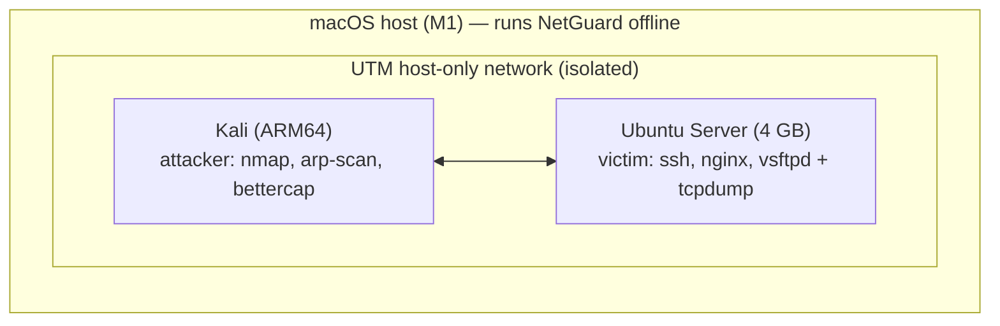

# Lab setup: validating NetGuard on real traffic

This guide builds an **isolated** lab on an Apple Silicon Mac with UTM:



> ⚠️ **Rules of engagement.** Run scans and ARP spoofing **only** on the
> host-only network. Never point them at your home, university (ITU) or ISP
> network. Scanning networks you do not own can be illegal, including under
> Turkish Penal Code art. 243–244, and violates acceptable-use policies.

## 1. Network

1. In UTM, set the network mode of **both VMs** to **Host Only**. The VMs can
   then reach each other and the Mac, but nothing beyond. UTM picks the subnet
   (often `192.168.128.0/24`); check it with `ip -br a` on each VM.
2. If you need internet access for package installs, add a *second* "Shared
   Network" NIC temporarily, install the packages, then remove it. Scan only
   the host-only interface.

## 2. Victim (Ubuntu Server 4 GB)

```bash
sudo apt update && sudo apt install -y tcpdump openssh-server nginx vsftpd
ip -br a                                   # note the host-only interface, e.g. enp0s1
```

Running services give the scans some *open* ports to find (22, 80, 21).

## 3. Attacker (Kali)

`nmap`, `arp-scan`, `masscan` and `bettercap` ship with Kali.

## 4. Capture an experiment

On **Ubuntu**, start one capture per experiment:

```bash
sudo tcpdump -i enp0s1 -s 0 -w ~/syn_scan.pcap
```

On **Kali** (replace `VICTIM`):

| Experiment | Command | Expected NetGuard result |
|---|---|---|
| SYN scan | `sudo nmap -sS VICTIM` | `portscan` HIGH, open 21/22/80 |
| Connect scan | `nmap -sT VICTIM` | `portscan` |
| XMAS / NULL / FIN | `sudo nmap -sX VICTIM` (`-sN`, `-sF`) | `portscan`, stealth noted |
| Slow scan | `sudo nmap -sS -T1 -p 1-50 VICTIM` | **probably missed** (known limitation) |
| UDP scan | `sudo nmap -sU --top-ports 50 VICTIM` | **missed** (no UDP detector yet) |
| ARP sweep | `sudo arp-scan --localnet` or `sudo nmap -sn 192.168.128.0/24` | `hostsweep` |
| Ping sweep (ICMP only) | `sudo nmap -sn -PE --send-ip 192.168.128.0/24` | `hostsweep` |
| ARP spoofing | `sudo bettercap -iface eth0 -eval "set arp.spoof.targets VICTIM; arp.spoof on"` (stop after 60 s) | `arpspoof` |
| Benign baseline | Use the victim normally for 1 h: `apt update`, browsing with `curl`, SSH sessions | **no alerts** is the goal |

Stop tcpdump with `Ctrl-C`, then copy the file to the Mac:

```bash
scp user@VICTIM:~/syn_scan.pcap captures/      # captures/ is git-ignored
uv run netguard analyze captures/syn_scan.pcap
```

> Note: the ARP-spoofing capture must be taken on the **victim** or on a host
> that sees the forged replies. With a host-only bridge, every VM sees
> broadcast ARP, and unicast replies addressed to the victim reach the victim.

## 5. Live mode on the victim

```bash
# On Ubuntu, after installing NetGuard (uv sync)
sudo tcpdump -i enp0s1 -U -w - 'not port 22' | uv run netguard analyze -f jsonl -
```

Filtering out your own SSH session (`not port 22`) keeps the analysis clean.

## 6. Recording results: manifest, Zeek, acceptance criteria

Write the expected result of every experiment **before** running NetGuard on
it, in `eval/captures.toml` (copy `eval/captures.example.toml`; the file is
git-ignored). For each capture: its SHA-256 after tcpdump has stopped, the
tool, `tool_version` and exact command, `provenance = "lab"`, `kind`, and the
expected `(detector, entity)` pairs. Then:

```bash
netguard lab evaluate --manifest eval/captures.toml --format json > eval/reports/lab.json
zeek -r captures/syn_scan.pcap LogAscii::use_json=T        # in an empty directory, on the same file
netguard lab compare-flows captures/syn_scan.pcap conn.log > eval/reports/syn_scan.zeek.json
```

Details and the meaning of every number: [CAPTURE_EVALUATION.md](CAPTURE_EVALUATION.md).

### Acceptance criteria (fixed before any lab result exists)

| Check | Pass when | Recorded as |
|---|---|---|
| Attack detection | Every planned attack experiment detected by ≥ 1 expected rule; entity-level recall ≥ 0.8 over all lab attacks | TP/FN per experiment, recall |
| Benign noise | ≥ 1 h of benign traffic with the default configuration: ≤ 1 final alert per hour; every alert explained | FP/hour, the alerts |
| Live = offline | `monitor --write` final alerts equal `analyze` of the written file, when tcpdump reports 0 kernel drops | diff of the two JSON outputs, drop counts |
| Flow states | `compare-flows` equal, or every mismatch explained in writing (timeouts, offload artefacts) | comparison JSON |
| Resources | 1 h live session: RSS stays below 500 MB, no state-loss warnings on benign traffic | `ps` samples, the summary line |
| Confidence | Each confidence factor separates true from false alerts on lab data, else it is removed | per-factor table |

A failed criterion is a result, not something to tune away silently: record
it in `EVALUATION.md § Real captures` with the fix or the limitation.

### Which machine does what

- **UTM host-only network (Kali → Ubuntu VM):** all scans, floods, ARP
  spoofing and the live-capture experiments. Nothing else.
- **The physical Ubuntu server on the home network:** never a target, and no
  capture on its home interface during attacks. It runs other services, which
  must not be changed. It can host NetGuard for offline analysis of copied
  lab captures, and a systemd test only with a separate unit and data
  directory, after the owner agrees.
- **The Mac:** runs NetGuard offline and Zeek (or Zeek in a container) on
  copied captures.

Do **not** commit captures, manifests with private addresses, or reports
until they have been reviewed.
