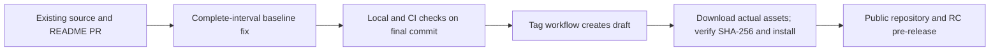

# NetGuard 1.0.0rc2 publication record

The strongest reason against stable 1.0 is missing new long-duration and repeated load evidence.
The baseline fix does not replace that evidence. This release remains a candidate.
Source publication does not promise production accuracy or stable performance.

## Changed

- Resolve task 8.17 with the [complete-interval decision](BASELINE_INTERVALS.md).
- Keep thresholds, epoch alignment, clipping and fixed-window limits unchanged.
- Include PR #10's bilingual README; PR #8, #9 and #10 are already merged.
- Align package, Python module, lock and frontend versions at `1.0.0rc2`.
- Review [confidence evidence](CONFIDENCE_REVIEW_RC2.md) without fitting weights to reused lab data.
- Prepare [remaining field experiments](FIELD_VALIDATION_PLAN.md), a bounded stepped TCP helper and CPU sampling.

## Executed checks

| Check | Result before final source commit |
|---|---|
| Python | 445 passed; coverage 93.32%, 90% gate retained |
| Quality | Ruff checks, formatting and strict mypy passed |
| Dashboard | 14 tests, typecheck and production build passed |
| Runtime dependencies | Locked Python runtime and frontend production dependencies report no known vulnerabilities |
| Synthetic detections | TP=20, FP=3, FN=1; 15/15 attack scenarios found by at least one expected rule |
| Existing real captures | 17 unique pinned captures match packet/flow/state/rule expectations |
| Zeek comparison | Matches after documented DNS/attempt timeouts; fragmented scan retains pinned 100/100 non-reassembly difference |
| Confidence review | 17 existing real captures, 21 final alerts, one benign capture; 12 synthetic benign scenarios reviewed separately |

All repeated references to those old captures refer to the same reused evidence.
They are not new live traffic, independent holdout data or repeated experiments.
The benign hour has no alerts and cannot validate confidence separation on benign alerts.
No numerical confidence weight is calibrated as an attack probability.

Final-commit CI, source-archive rebuilding, downloaded draft checks and clean wheel installation are publication gates.
The publication report records their actual run URLs and exact commit after execution.
A commit cannot contain its own completed CI result.

## Security and package review

All fetched remote branches and reachable history are scanned before visibility changes.
All available historical Actions logs and 14 existing workflow artifacts were inspected.
The artifact review expands nested wheels/source archives and rejects real captures, databases and key files.
No verified secret was found in the initial review; the final source tree is scanned again before publication.
Old lab captures remain private because some contain HTTP control tokens.
Neither raw captures nor local data directories are release assets.

## Remaining limits

- No newly executed live capture longer than one hour or repeated stepped-load run without guest sudo/control access.
- No broad production false-positive rate, held-out calibration, hardware-independent throughput or latency guarantee.
- Fixed windows can split a burst; partial first and final intervals are excluded from baseline scoring.
- No fragmented IP reassembly; fragment probes need not reach the scan rules.
- Linux workers have CPU/time/address-space limits. macOS lacks the Linux address-space memory cap.
- The passive analyser sees only packets visible at its capture point; zero kernel drops do not prove end-to-end completeness.

## Upgrade and rollback

1. Stop the local API before backing up its data directory.
2. Verify release `SHA256SUMS` against downloaded assets.
3. Install the wheel with the matching locked requirements as constraints.
4. Start the service and confirm health version `1.0.0rc2` and existing analyses.

There is no database schema change in this candidate.
Baseline learning is session-local; existing saved analyses are not silently recalculated.
To compare results, reanalyse a retained capture and keep its original result for reference.
For rollback, stop the service, install the previous wheel/environment and restore its matching data backup.
Keep old and new backups separate; never include their contents in Git or release uploads.
